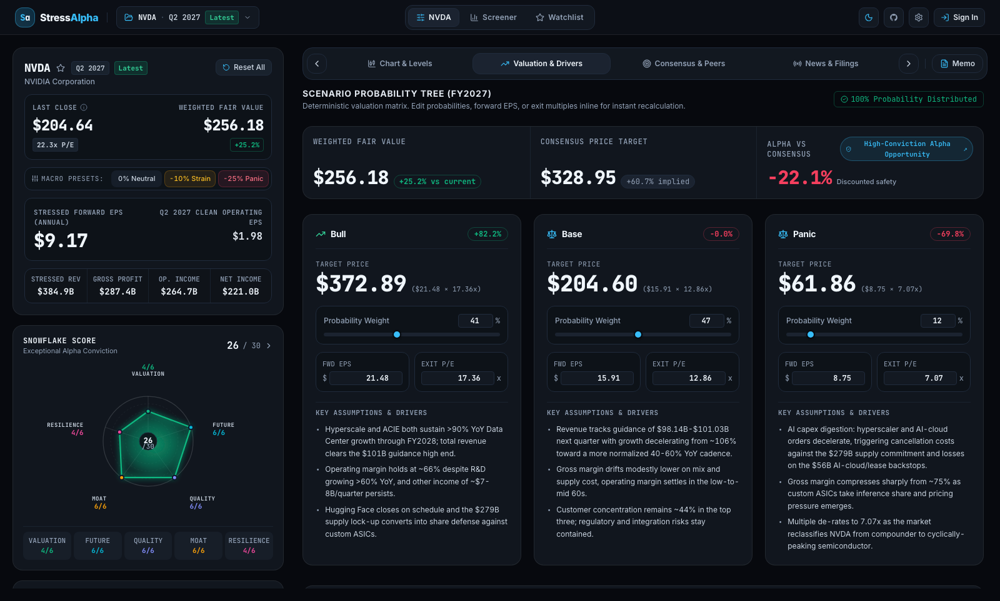
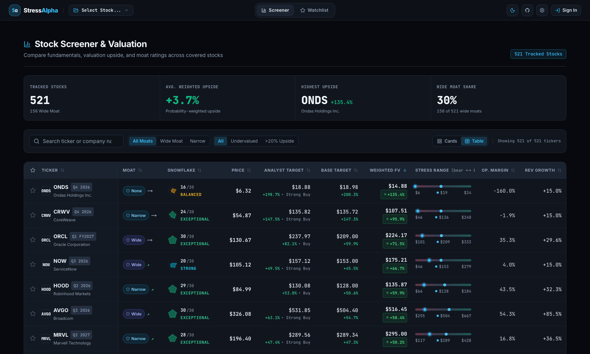
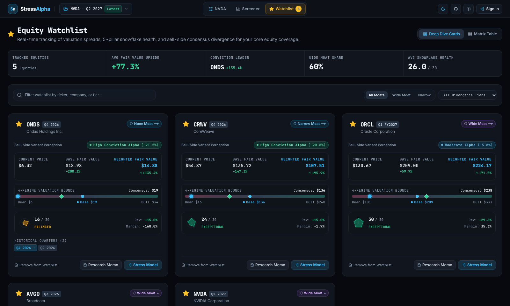
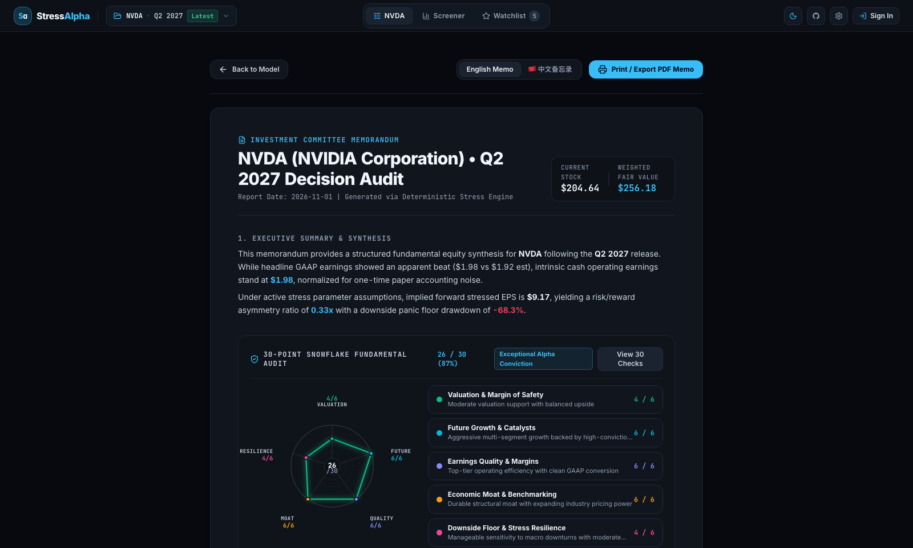

# StressAlpha — Equity Earnings & Scenario Stress Simulation Platform

StressAlpha is an interactive financial modeling and scenario stress-simulation platform for fundamental equity analysts and institutional investors. Built with **Next.js 16 (App Router)**, **React 19**, **TypeScript**, and **Neon Serverless PostgreSQL**, it pairs deterministic real-time valuation engines with automated SEC filing ingestion pipelines.

---

## 📸 Platform Overview

### 1. Interactive Dual-Pane Cockpit
The left pane anchors deterministic flow-through valuation models, live TTM/NTM P/E anchors, and real-time sensitivity controls. The right pane navigates 3 streamlined analysis workspaces (Chart & Levels, Valuation & Drivers, Consensus & Peers) plus persistent per-stock Analyst Notes with independent scrolling.

<p align="center">
  
</p>

### 2. Market Home, S&P 500 Treemap & Earnings Docket
Monitor live major index benchmarks (`SPY`, `QQQ`, `DIA`, `IWM`, `^VIX`, `^TNX`), an interactive squarified S&P 500 & NASDAQ-100 sector heatmap, top valuation movers, and a 14-day Upcoming Earnings Docket with Watchlist-Only filtering and Market Cap sorting.

### 3. Universe Screener & Multi-Factor Matrix
Filter, rank, and evaluate valuation spreads, 11 GICS sector categories, consensus price targets, and 30-point Snowflake Fundamental Radars across 521 covered equities (with 640+ multi-quarter earnings reports) via a streamlined single-row dropdown control bar and fixed-width tabular/card views.

<p align="center">
  
</p>

### 4. Coverage Watchlist & Per-Stock Analyst Notes
Monitor core positions with real-time quote feeds, multi-regime stress boundaries, margin trends, and cloud-synced per-stock Analyst Notes (`user_notes`) that carry automatically into research memos.

<p align="center">
  
</p>

### 5. 1-Click Investment Committee Memorandum (`[M]` key)
Generates an institutional PDF-styled research memo rendering thesis drivers, consensus divergence, catalyst timetables, valuation sensitivity matrices, and custom analyst notes.

<p align="center">
  
</p>

---

## ✨ Key Capabilities

* **Deterministic Valuation Engine**: All financial models—including Weighted Fair Value (WFV), operating leverage flow-through, and multiple sensitivity—are calculated client-side in pure TypeScript (`<1ms` recalculation latency) with zero synthetic UI placeholders.
* **4-Regime Scenario Stress Testing**: Evaluates cash generation and downside floors across Bull, Base, Bear, and Panic scenarios, modeling operating margin rigidity and upstream volume shocks.
* **Microstructure & Fundamental Confluence**: Combines floor pivots ($P, S_1-S_3, R_1-R_3$), gap edges, 1-year volume profile Point of Control (POC), and Anchored VWAPs with valuation regimes to identify institutional price confluence within $\pm 2.5\%$.
* **30-Point Snowflake Fundamental Radar**: Multi-factor fundamental audit across Valuation, Future Growth, Earnings Quality, Moat Durability, and Balance Sheet Resilience.
* **Zero-Key SEC EDGAR & Yahoo Finance Pipeline**: Automated ingestion syncing quarterly financial statements, 1-year OHLCV bars, sell-side consensus targets, and official SEC 10-Q/10-K/8-K filings directly into typed relational schemas without paid third-party data vendor locks.
* **Bilingual Parity**: Full English and Chinese localization (`en` / `zh`) across workspaces, research memos, and interactive methodology documentation.

---

## 🏃 Quick Start

### 1. Clone & Install Dependencies
```bash
git clone https://github.com/phanturne/stress-alpha.git
cd stress-alpha
npm install
```

### 2. Configure Environment
Copy `.env.example` to `.env.local` and add your database credentials:
```bash
cp .env.example .env.local
```
*(Requires `DATABASE_URL` for Neon PostgreSQL. Core SEC EDGAR & Yahoo Finance data pipelines run out-of-the-box with zero external API keys; optional `AI_GATEWAY_API_KEY` for qualitative enrichment).*

### 3. Run Automated Tests
Spins up an isolated, ephemeral copy-on-write Neon DB branch in ~1.0s for 100% cloud parity:
```bash
npm test
```

### 4. Launch Development Server
```bash
npm run dev
```
Open [http://localhost:3000](http://localhost:3000) to view the cockpit.

---

## 🏗️ Architecture & Stack

| Layer | Technology | Engineering Highlights |
| :--- | :--- | :--- |
| **Framework** | Next.js 16 App Router, React 19, Turbopack | Server components with client-side reactive modeling |
| **Styling & UI** | Tailwind CSS, Pure SVG Charts | Zero canvas/heavy chart dependencies; dark/light FactSet theme |
| **Database & ORM** | Neon Serverless PostgreSQL, Drizzle ORM | Normalized relational time-series tables; repository pattern |
| **Testing** | Vitest, Neon Ephemeral Branching | 320+ integration tests across 32 suites with isolated copy-on-write cloud DB branches |
| **Data Pipelines** | Official SEC EDGAR, Yahoo Finance (`yahoo-finance2`) | Zero-key ETL with rate-budgeting, exponential backoff, and deduplication |

---

## 📚 Deep-Dive Documentation

* 📐 **[System Architecture Documentation (`docs/architecture.md`)](./docs/architecture.md)** — Relational schema design, data access patterns, and batch ingestion DAGs.
* 🔬 **[Valuation Methodology & Derivations](https://stressalpha.vercel.app/methodology)** — Mathematical models for volume shock elasticity, operating leverage rigidity, and FCF yields.
