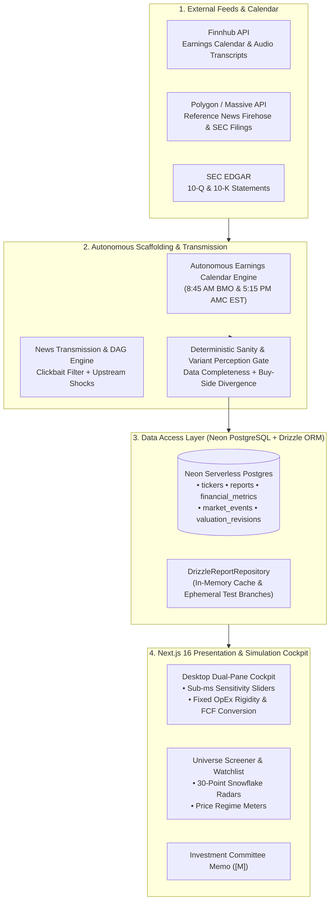
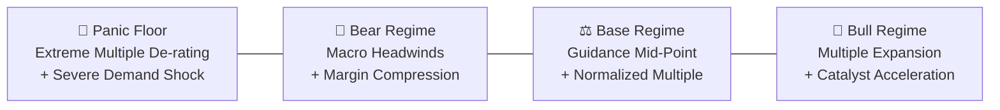

# StressAlpha — Modern Equity Earnings & Stress Simulation Platform

A forward-looking financial decision and scenario-simulation platform for fundamental equity analysts, tech investors, and quant researchers. Built as a high-performance **Next.js 16 App Router** application (powered by **React 19** and **Turbopack**) with pure client-side deterministic arithmetic, dynamic valuation bands, and autonomous earnings intelligence pipelines.

---

## 📸 Platform Interface Gallery

### 1. Interactive Flow-Through Cockpit (Desktop Dual-Pane)
The left pane anchors the deterministic flow-through valuation model and sensitivity sliders, while the right pane navigates 8 deep-dive intelligence workspaces with independent scrolling.

<p align="center">
  
</p>

### 2. Cross-Ticker Universe Screener & Radar Matrix
Analyze valuation multiples, consensus upside spreads, and 30-point Snowflake Fundamental Radars across 630+ covered equities with adaptive card and table views.

<p align="center">
  
</p>

### 3. Dedicated Watchlist Portfolio & Telemetry
Track coverage lists with real-time quote updates, valuation spreads, operating margins, and multi-quarter earnings history.

<p align="center">
  
</p>

### 4. 1-Click Investment Committee Memorandum (`[M]` key)
Instant publication-ready PDF-styled research memo rendering thesis bullets, variant perception commentary, catalyst timetables, and valuation sensitivity ranges.

<p align="center">
  
</p>

---

## 💡 Core Philosophy & System Architecture

> **LLMs extract and audit qualitative context; pure deterministic TypeScript handles 100% of the arithmetic.**



1. **Zero LLM Math Hallucinations**:
   - Target prices, weighted fair values (WFVs), multiple spreads, and snowflake scores are **never** calculated or guessed by an LLM.
   - All financial mathematics, operating leverage flows, and risk/reward asymmetries are strictly computed by deterministic TypeScript engines (`src/lib/valuation.ts`, `src/lib/snowflake.ts`).
2. **Income Quality Guardrail**:
   - Automatically isolates non-operating, mark-to-market one-off paper gains (e.g. ASU 2016-01 equity adjustments) to surface true `Operating EPS`, preventing valuation multiple distortion.
3. **Sub-Millisecond Client Reactivity**:
   - Sliders perturbing upstream demand shocks (Hyperscaler CapEx, Consumer Demand, Digital Ad spend) evaluate instantly (`<1ms`) client-side without round-trip network delays.
4. **Isolated Ephemeral Integration Testing**:
   - Automated via Vitest and the Neon API: tests spin up an isolated copy-on-write branch from `production` in ~0.85s, ensuring 100% cloud parity without polluting production data.

---

## 🔬 Deterministic Valuation Mechanics

StressAlpha models corporate cash generation across a **4-Regime Valuation Spectrum**:



### Flow-Through Equations
1. **Top-Line Demand Shocks**:
   $$\Delta \text{Revenue} = \text{Base Revenue} \times \sum_{i} \left( \text{Exposure}_i \times \text{Elasticity}_i \times \text{Shock}_i \right)$$
2. **Operating Leverage Rigidity**: Fixed operating expenditures (`fixedOpexBillions`) do not contract proportionally with revenue during downturns, realistically modeling operational deleveraging.
3. **Free Cash Flow (FCF) Conversion & Yield**:
   $$\text{FCF} = \text{Operating Income} \times (1 - \text{Tax Rate}) + \text{D\&A} - \text{CapEx}$$
   $$\text{FCF Conversion } \% = \frac{\text{FCF}}{\text{Net Income}} \times 100, \quad \text{FCF Yield } \% = \frac{\text{FCF Per Share}}{\text{Stock Price}} \times 100$$
4. **Softmax Multi-Regime Weighting with Tail Risk Heuristics**:
   - Applies an asymmetric governance tail veto ($\Delta z_{\text{panic}} = +1.35, \Delta z_{\text{bull}} = -1.60$) overriding margin cushions when severe accounting flags arise.
   - Regularized by a 20% market-implied anchor ($w_{\text{mkt}} = 0.20$) on a bounded simplex $[0.05, 0.85]$.

---

## ❄️ 30-Point Snowflake Fundamental Radar

The circular fundamental radar scores companies across 5 core pillars (6 points each, 30 points max):

| Pillar | Axis ID | Focus & Evaluation Criteria | Token Color |
| :--- | :--- | :--- | :--- |
| **Valuation & Margin of Safety** | `valuation` | Upside to WFV, discount to consensus target, multiple discipline | Emerald (`#10b981`) |
| **Future Growth & Catalysts** | `future` | Segment revenue velocity, forward guidance, catalyst pipeline | Cyan (`#06b6d4`) |
| **Earnings Quality & Margins** | `earnings` | Operating margin level, clean cash conversion, GAAP equity adjustments | Indigo (`#6366f1`) |
| **Economic Moat & Benchmarking** | `moat` | Pricing power, peer margin spread, durable switching costs | Amber (`#f59e0b`) |
| **Downside Floor & Resilience** | `resilience` | Panic multiple buffer, upstream solvency, asymmetry skew ratio | Rose (`#ec4899`) |

---

## ⚡ CLI & Pipeline Commands

| Command | Description |
| :--- | :--- |
| `npm run dev` | Start Next.js development server at `http://localhost:3000` |
| `npm test` | Run Vitest test suite (244 tests) with Neon ephemeral copy-on-write branching |
| `npm run build` | Compile Next.js production build with Turbopack |
| `npm run sync:earnings -- --dry-run` | Simulate earnings calendar ingestion for today |
| `npm run sync:earnings -- --date=YYYY-MM-DD` | Ingest and scaffold earnings reports for a specific date |
| `npm run sync:news -- --firehose` | Ingest and filter market-wide news via Polygon global firehose |
| `npm run sync:prices` | Update live market prices across coverage universe |
| `npm run fetch:data -- <TICKER> --stage` | Ingest SEC statements and scaffold starter draft modules |
| `npm run migrate:metrics` | Backfill relational quarterly time-series statements into `financial_metrics` |
| `npm run capture:screenshots` | Capture fresh headless screenshots of all core platform views |

---

## 🛠️ Project Structure

```
stress-alpha/
├── .github/workflows/
│   ├── ci.yml                          # Continuous integration (format, lint, tsc, test, build)
│   ├── nightly-price-sync.yml          # Nightly price & news sync (22:00 UTC)
│   └── earnings_sync.yml               # Twice-daily automated earnings scaffolding (8:45 AM & 5:15 PM EST)
├── docs/
│   ├── architecture.md                 # Canonical system architecture documentation & diagrams
│   └── images/                         # Platform screenshots (cockpit, screener, watchlist, memo, methodology)
├── scripts/
│   ├── sync_earnings_calendar.ts       # Finnhub earnings calendar ingestion & scaffolding
│   ├── sync_news.ts                    # Polygon firehose news ingestion & transmission calculation
│   ├── sync_prices.ts                  # Market price synchronization (batch-accelerated)
│   ├── fetch_data.ts                   # SEC 10-Q & consensus pipeline data extractor
│   ├── seed_universe.ts                # S&P 500 & NASDAQ-100 universe ingestion & quote seeder
│   ├── bulk_scaffold.ts                # Batch valuation scaffolding & report persistence engine
│   ├── seed_upstream_dependencies.ts   # Cross-company supply chain DAG seeder
│   └── capture_screenshots.sh          # Headless browser screenshot capture script
├── src/
│   ├── app/                            # Next.js 16 App Router pages & API routes
│   │   ├── page.tsx                    # Main valuation model & workspace cockpit
│   │   ├── screener/                   # Dedicated cross-ticker screener (/screener)
│   │   ├── watchlist/                  # Dedicated coverage watchlist (/watchlist)
│   │   ├── settings/                   # Dedicated settings & privacy hub (/settings)
│   │   ├── methodology/                # Interactive mathematical methodology guide (/methodology)
│   │   └── api/                        # REST API routes (reports, news, revisions, watchlist, pipeline)
│   ├── components/                     # React 19 UI components
│   │   ├── Header.tsx                  # Global 3-tab segmented navigation bar & theme toggle
│   │   ├── Cockpit.tsx                 # Interactive flow-through model & sliders
│   │   ├── CockpitDualPane.tsx         # Desktop dual-pane independent scroll container
│   │   ├── ScreenerView.tsx            # Multi-ticker radar table & adaptive cards
│   │   ├── WatchlistView.tsx           # Dedicated watchlist telemetry strip & metrics
│   │   ├── snowflake/                  # 5-Pillar Snowflake Radar chart & modal
│   │   └── tabs/                       # 8 Specialized intelligence workspaces
│   ├── db/                             # Neon Serverless Postgres schema & connection pool
│   └── lib/                            # Core domain logic
│       ├── valuation.ts                # Deterministic arithmetic, FCF metrics & scenario calibration
│       ├── snowflake.ts                # 30-point fundamental health scoring engine
│       ├── sanity.ts                   # Variant perception & data completeness audit
│       ├── news-filter.ts              # Clickbait & class-action lawsuit spam filter
│       ├── news-transmission.ts        # Event-to-valuation transmission engine
│       ├── services/                   # Earnings calendar, financial data, and news services
│       └── repository/                 # Data Access Layer (Drizzle & InMemory repositories)
└── tests/                              # Vitest automated test suite (244 tests across 24 suites)
```

---

## 🏃 Getting Started

### 1. Install Dependencies
```bash
npm install
```

### 2. Configure Environment
Copy `.env.example` to `.env.local` and configure your API credentials:
```bash
cp .env.example .env.local
```
Key environment variables:
* `DATABASE_URL`: Neon Serverless PostgreSQL connection string.
* `MASSIVE_API_KEY`: API key for point-in-time financial statements and news.
* `FINNHUB_API_KEY`: API key for earnings calendar and earnings call transcripts.
* `NEON_API_KEY` & `NEON_PROJECT_ID`: Optional credentials for running ephemeral Vitest integration branches.

### 3. Verify System Health
Run the comprehensive test suite (Vitest spins up an isolated, ephemeral copy-on-write Neon DB branch in ~0.85s):
```bash
npm test
npm run build
```

### 4. Launch Development Server
```bash
npm run dev
```
Open [http://localhost:3000](http://localhost:3000) in your browser.
