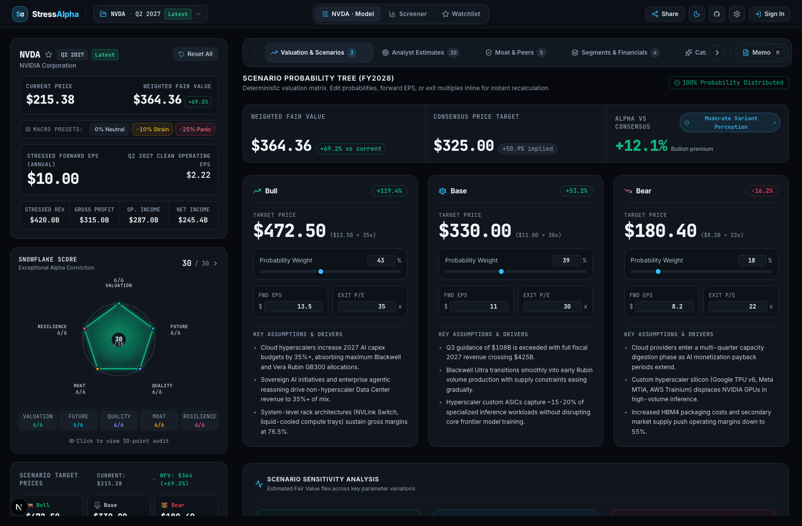

# StressAlpha — Modern Equity Earnings & Stress Simulation Platform

A forward-looking financial decision and scenario-simulation platform for fundamental equity analysts, tech investors, and quant researchers. Built as a high-performance **Next.js 16 App Router** application (powered by **React 19** and **Turbopack**) with pure client-side deterministic arithmetic, dynamic valuation bands, and an autonomous AI pipeline skill.

<p align="center">
  
</p>

---

## 💡 Core Philosophy

> **LLMs extract and audit qualitative context; pure deterministic TypeScript handles 100% of the arithmetic.**

* **Zero Math Hallucinations**: Target prices, weighted fair values (WFVs), multiple spreads, and snowflake scores are never invented by an LLM. All financial mathematics and operating leverage flows are strictly calculated by deterministic TypeScript engines.
* **Audited SEC Data Extraction**: Point-in-time financial statements, 10-Q/10-K filings, and earnings call transcripts are extracted via [Massive.com](https://massive.com/pricing) and [Finnhub.io](https://finnhub.io/pricing).
* **Income Quality Guardrail**: Automatically isolates non-operating, mark-to-market one-off gains (e.g. ASU 2016-01 equity adjustments) to surface true `Operating EPS`, preventing valuation multiple distortion.

---

## 🚀 Key Features

### 1. Interactive Flow-Through Stress Model Cockpit
* **Sub-Millisecond Sensitivity Sliders**: Real-time client-side simulation (<1ms) perturbing upstream demand shocks (Hyperscaler CapEx, Consumer Demand, Digital Ad spend) with exposure shares and elasticities.
* **4-Regime Valuation Spectrum**:
  * 🐂 **Bull Regime**: Multiple expansion and catalyst acceleration scenario.
  * ⚖️ **Base Regime**: Guidance execution and normalized valuation multiple.
  * 🐻 **Bear Regime**: Deceleration and macro margin compression.
  * 🚨 **Panic Floor**: Extreme multiple de-rating and demand contraction floor.
* **Risk/Reward Asymmetry**: Real-time gauge pin positioning the market price against regime boundaries and computing the Upside-to-Downside skew ratio.

### 2. Autonomous Earnings Calendar & Scaffolding Engine
* **Inverted Daily Polling**: Queries Finnhub's earnings calendar (`GET /calendar/earnings`) once or twice daily to identify every reporting company across US markets in a single request.
* **Automated Scaffolding**: Automatically runs at **8:45 AM EST** (post-BMO) and **5:15 PM EST** (post-AMC) via GitHub Actions, auto-scaffolding all 8 quarterly modules (both English & Chinese), computing deterministic valuations, and running sanity audits.
* **Non-Destructive Deduplication**: Skips populated reports (`revenueBillions > 0`) while enabling forced re-scaffolding with `--force` and simulation with `--dry-run`.

### 3. Global News Firehose & Supply Chain Transmission Pipeline
* **Unparameterized Marketplace Streaming**: Ingests up to 1,000 articles in a single query via Polygon / Massive Reference News API (`GET /v2/reference/news?limit=1000`).
* **Noise & Clickbait Gating**: Deterministic regex filters eliminate ~90% of syndicated clickbait, wealth formulas, and class-action lawyer solicitation spam before any processing occurs.
* **Cross-Company Dependency Graph (DAG)**: Propagates upstream supplier/customer announcements (e.g. TSMC CapEx or ASML bookings) downstream to customer valuations (e.g. NVIDIA revenue) without duplicate extractions.
* **Valuation Revision Ledger**: Maintains an immutable audit trail of event-driven baseline valuation adjustments between quarterly earnings releases.

### 4. Cross-Ticker Universe Screener & Dedicated Watchlist
* **Market-Wide Comparison**: Side-by-side overview of all covered equities with real-time closing prices, market caps, and consensus price targets sorted by upside potential.
* **Valuation Spread Spectrum Bars**: Visual Bear $\leftrightarrow$ Market Price $\leftrightarrow$ Base $\leftrightarrow$ Bull spread bars identifying deep-value discounts.
* **Standalone Routes**: Dedicated routes for `/screener` and `/watchlist` with dynamic count badges, multi-quarter grouping, and dual view modes (Adaptive Cards vs Matrix Table).
* **30-Point Snowflake Fundamental Radar**: 5-pillar fundamental health score (Valuation & Safety, Future Growth, Earnings Quality, Economic Moat, Downside Resilience).

### 5. Institutional Intelligence Workspaces & PDF Memo Mode
* **8 Focused Workspaces**:
  1. *Valuation & Scenario Tree*: Bull/Base/Bear matrix with inline-editable EPS and multiples.
  2. *Wall Street Estimates*: Street consensus targets, upside spreads, and revision history.
  3. *Economic Moat*: 5-pillar moat evaluation and competitor benchmarking.
  4. *Segments & Guidance*: Segment velocities and management forward guidance ranges.
  5. *Catalysts*: Quantified growth/risk drivers with probability anchors and horizons.
  6. *News & Pulse*: Live market event feed with abnormal price moves and "Simulate in Cockpit" triggers.
  7. *Audit & Risk*: SEC 10-Q disclosures, management tone scorecard, and post-earnings stock reactions.
  8. *Research Memo*: Bilingual report markdown (`report.md` / `report_zh.md`) with 1-click clipboard copy.
* **1-Click Printable Memo (`[M]` key)**: Instant publication-ready 1-page PDF memorandum for investment committees.

### 6. Institutional UI & Dual-Theme Engine
* **Dual Themes**: Default Bloomberg Terminal Dark (`#07090e`) and FactSet/WSJ Day Light (`#f8fafc`) with zero-flash (`0ms FOUC`) SSR persistence.
* **Zero-Exposure Email Privacy**: User emails are omitted from header menus and mobile drawers, and masked by default on `/settings` to safeguard against shoulder-surfing and presentation leaks.
* **Desktop Dual-Pane Independent Scroll**: Locked window scroll on desktop eliminates jumpy double scrollbars; left model and right deep-dive workspaces scroll independently.

> [!NOTE]
> For complete mathematical proofs, formulas, and worked examples (including QPCE logit-space calibration and ASU 2016-01 adjustments), visit the interactive **[/methodology](http://localhost:3000/methodology)** page or [`docs/architecture.md`](./docs/architecture.md).

---

## ⚡ CLI Quick Reference

| Command | Description |
| :--- | :--- |
| `npm run dev` | Start Next.js development server at `http://localhost:3000` |
| `npm test` | Run Vitest test suite with Neon ephemeral copy-on-write branching |
| `npm run build` | Compile Next.js production build with Turbopack |
| `npm run sync:earnings -- --dry-run` | Simulate earnings calendar ingestion for today |
| `npm run sync:earnings -- --date=YYYY-MM-DD` | Ingest and scaffold earnings reports for a specific date |
| `npm run sync:news -- --firehose` | Ingest and filter market-wide news via Polygon global firehose |
| `npm run sync:prices` | Update live market prices across coverage universe |
| `npm run fetch:data -- <TICKER> --stage` | Ingest SEC statements and scaffold starter draft modules |

---

## 🛠️ Project Structure

```
stress-alpha/
├── .github/workflows/
│   ├── ci.yml                          # Continuous integration (format, lint, tsc, test, build)
│   ├── nightly-price-sync.yml          # Nightly price & news sync (22:00 UTC)
│   └── earnings_sync.yml               # Twice-daily automated earnings scaffolding (8:45 AM & 5:15 PM EST)
├── docs/
│   ├── architecture.md                 # Canonical system architecture documentation
│   └── images/                         # UI preview screenshots
├── scripts/
│   ├── sync_earnings_calendar.ts       # Finnhub earnings calendar ingestion & scaffolding
│   ├── sync_news.ts                    # Polygon firehose news ingestion & transmission calculation
│   ├── sync_prices.ts                  # Market price synchronization (batch-accelerated)
│   ├── fetch_data.ts                   # SEC 10-Q & consensus pipeline data extractor
│   ├── seed_universe.ts                # S&P 500 & NASDAQ-100 universe ingestion & quote seeder
│   ├── bulk_scaffold.ts                # Batch valuation scaffolding & report persistence engine
│   └── seed_upstream_dependencies.ts   # Cross-company supply chain DAG seeder
├── src/
│   ├── app/                            # Next.js 16 App Router pages & API routes
│   │   ├── page.tsx                    # Main valuation model & workspace cockpit
│   │   ├── screener/                   # Dedicated cross-ticker screener (/screener)
│   │   ├── watchlist/                  # Dedicated coverage watchlist (/watchlist)
│   │   ├── settings/                   # Dedicated settings & privacy hub (/settings)
│   │   ├── methodology/                # Interactive mathematical methodology guide (/methodology)
│   │   └── api/                        # REST API routes (reports, news, revisions, watchlist, pipeline)
│   ├── components/                     # React 19 UI components
│   │   ├── Header.tsx                  # Global navigation bar & theme toggle
│   │   ├── Cockpit.tsx                 # Interactive flow-through model & sliders
│   │   ├── ScreenerView.tsx            # Multi-ticker radar table & cards
│   │   ├── WatchlistView.tsx           # Dedicated watchlist telemetry strip & metrics
│   │   ├── snowflake/                  # 5-Pillar Snowflake Radar chart & modal
│   │   └── tabs/                       # 8 Specialized intelligence workspaces
│   ├── db/                             # Neon Serverless Postgres schema & connection pool
│   └── lib/                            # Core domain logic
│       ├── valuation.ts                # Deterministic arithmetic & QPCE scenario calibration
│       ├── snowflake.ts                # 30-point fundamental health scoring engine
│       ├── sanity.ts                   # Variant perception & data completeness audit
│       ├── news-filter.ts              # Clickbait & class-action lawsuit spam filter
│       ├── news-transmission.ts        # Event-to-valuation transmission engine
│       ├── services/                   # Earnings calendar, financial data, and news services
│       └── repository/                 # Data Access Layer (Drizzle & InMemory repositories)
└── tests/                              # Vitest automated test suite (207 tests across 21 suites)
```

---

## 🏃 Getting Started

### 1. Install Dependencies
```bash
npm install
```

### 2. Configure Environment
Copy `.env.example` to `.env.local` and configure your API credentials:
```bash
cp .env.example .env.local
```
Key environment variables:
* `DATABASE_URL`: Neon Serverless PostgreSQL connection string.
* `MASSIVE_API_KEY`: API key for point-in-time financial statements and news.
* `FINNHUB_API_KEY`: API key for earnings calendar and earnings call transcripts.

### 3. Verify System Health
Run the comprehensive test suite (Vitest spins up an isolated, ephemeral copy-on-write Neon DB branch in ~1s):
```bash
npm test
npm run build
```

### 4. Launch Development Server
```bash
npm run dev
```
Open [http://localhost:3000](http://localhost:3000) in your browser.
