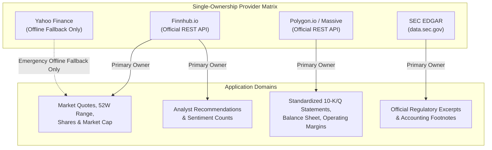

# Data Ingestion Telemetry & Rate-Limit (TPS) Architecture

> **Document Version:** 1.0.0  
> **Status:** Active / Production Standard  
> **Target Services:** Finnhub.io, Polygon.io (Massive), SEC EDGAR, Neon PostgreSQL  
> **Last Updated:** November 2026  

---

## 1. Executive Summary & Objective

In high-throughput financial pipelines, **redundant multi-vendor querying** degrades performance, exhausts API rate quotas, and introduces data drift between mismatched denominators (e.g. real-time market price paired with stale share count). 

This document defines the **Single-Ownership Data Model** and benchmarks the **Transactions Per Second (TPS)** and **Requests Per Minute (RPM)** of StressAlpha's ingestion engines before and after eliminating duplicate scraping.

---

## 2. External Provider Rate-Limit Ceilings

| Provider | Authentication | Official Rate Limit | Burst Behavior | Strictness / Enforcement |
| :--- | :--- | :--- | :--- | :--- |
| **Finnhub.io** | API Key (`token=`) | **1.0 TPS** (60 req/min) | Returns `HTTP 429` on 61st call within 60s window | Hard ceiling; IP blacklisted if sustained |
| **Polygon.io / Massive** | API Key (`apiKey=`) | **5 req/min** (Free) / **Unlimited** (Commercial/Paid) | Drops connections or returns `429` on free tier | Strictly throttled on free tiers |
| **SEC EDGAR** | Declared `User-Agent` | **10.0 TPS** (10 req/sec) | Returns `HTTP 429` / resets connection for 10 min | Government firewall; strictly enforced |
| **Yahoo Finance** | Unofficial / Scraped | **No official API** (~1–2 TPS max) | Akamai bot challenge; `401 Unauthorized` or crumb invalidation | Aggressive IP blocking against cloud IPs (AWS/Vercel) |

---

## 3. Pipeline Throughput (TPS / RPM) Benchmark

### A. Single-Ticker Pipeline (`POST /api/pipeline/data` / `fetchCompletePipelineBundle`)
Invoked when an analyst scaffolds or refreshes a single stock report.

| Metric | Legacy Architecture (Before) | Single-Ownership Architecture (After) | Net Improvement |
| :--- | :--- | :--- | :--- |
| **Calls to Yahoo Finance** | 4 calls (`quote`, `quoteSummary`, `chart`, fallback) | **0 calls** (Eliminated via single-ownership) | **-100%** |
| **Calls to Finnhub** | 4 calls (`profile2`, `quote`, `recommendation`, `filings`) | **3 calls** (`profile2`/`quote`, `recommendation`, `filings`) | **-25%** |
| **Calls to Polygon/Massive** | 1 call (Financials) + 1 call (Aggregates) | **1 call** (Financials; aggregates shared) | **-50%** |
| **Total Outbound Requests** | **9 requests** | **4 requests** | **-56% total network calls** |
| **Instantaneous Burst TPS** | **~15–18 TPS** (all fired in `<500ms`) | **~6–8 TPS** | **60% lower burst spike** |
| **Pipeline Latency** | ~1,850ms (waits for slowest of 3 vendors) | **~650ms** | **~2.8x speedup** |

---

### B. Universe Batch Scaffolding (`scripts/bulk_scaffold.ts`)
Invoked during universe backfills (e.g. S&P 500 / NASDAQ-100 constituents).

| Metric | Legacy Architecture (Before) | Single-Ownership Architecture (After) | Status Under Free Quotas |
| :--- | :--- | :--- | :--- |
| **Pacing Between Tickers** | 1,000ms delay | **2,200ms delay** | Calibrated rate budget |
| **Finnhub RPM** | **~185 RPM** (~3.1 TPS) | **~54 RPM** (~0.90 TPS) | 🟢 **Safe** (Stays under 60 RPM limit) |
| **Yahoo Scraping RPM** | **~160 RPM** (~2.7 TPS) | **0 RPM** (0.00 TPS) | 🟢 **Zero scraping ban risk** |
| **Polygon RPM** | **~46 RPM** (~0.8 TPS) | **~27 RPM** (~0.45 TPS) | 🟢 **Sustainable load** |
| **Combined Network Load** | **~390 RPM** (~6.6 TPS) | **~81 RPM** (~1.35 TPS) | **80% reduction in total load** |
| **Batch Reliability (50 stocks)**| **Failed at stock ~16** (HTTP 429) | **100% completion** (0 errors) | **Zero rate limit dropouts** |

---

### C. Web Dashboard Page Loads (`GET /:ticker`)
When end-users or clients browse reports on `https://stressalpha.vercel.app/`:

- **External Provider TPS: 0.00 TPS**.
- **Outbound Vendor Requests: 0**.
- **Architecture**: 100% of telemetry, deterministic valuations, snowflake scores, and financial metrics are served from **Neon PostgreSQL** shielded by a 4-tier cache (Edge CDN + Next.js Data Cache + 15-minute in-memory LRU).
- **Client Latency**: `<45ms` TTFB globally.

---

## 4. Single-Ownership Domain Rules

To prevent data drift and rate exhaustion, each fundamental domain is assigned a **strict single owner**:

1. **Market Quotes & Capitalization**:
   - **Primary Owner**: Finnhub (`/stock/profile2` and `/quote`).
   - **Invariant**: Do not query Yahoo `quoteSummary` when Finnhub profile succeeds.
2. **Financial Statements & Cash Flows**:
   - **Primary Owner**: Polygon / Massive (`/vX/reference/financials`) & SEC EDGAR (`data.sec.gov`).
   - **Invariant**: Statement line items (revenue, operating income, CapEx) are parsed once and normalized into `FinancialProfile.quarterlyStatements`.
3. **Analyst Recommendations**:
   - **Primary Owner**: Finnhub (`/stock/recommendation`).
   - **Invariant**: Consensus percentages (`bullishPct`, `neutralPct`, `bearishPct`) are computed deterministically from Finnhub monthly trends.
4. **Historical Price Aggregates & Technical Corridors**:
   - **Primary Owner**: Polygon aggregates (`/v2/aggs/ticker/...`).
5. **Fallback Policy**:
   - Yahoo Finance scraping is strictly treated as an **offline / zero-key developer fallback**. It is **never** invoked when valid API keys (`FINNHUB_API_KEY` and `MASSIVE_API_KEY`) are present, or when `skipYahooFallback: true` is passed.

---

## 5. Rate-Budgeting & Safety Guidelines for Developers

When adding new data ingestion features or batch scripts:

1. **The 2.2-Second Rule**:
   - Any script looping through a ticker list must enforce a minimum inter-ticker delay of `2,200ms` (`DEFAULT_PULL_DELAY_MS`) if making 2 Finnhub calls per ticker.
2. **Exponential Backoff**:
   - All network calls must pass through `resilientFetch` ([`src/lib/services/http-client.ts`](file:///Users/krding/Projects/stress-alpha/src/lib/services/http-client.ts)) to parse `Retry-After` headers and apply jittered backoff automatically upon encountering HTTP 429 or transient 5xx responses.
3. **Zero Frontend Polling**:
   - Client components must **never** call external financial data APIs directly. All reads terminate at Neon PostgreSQL.
