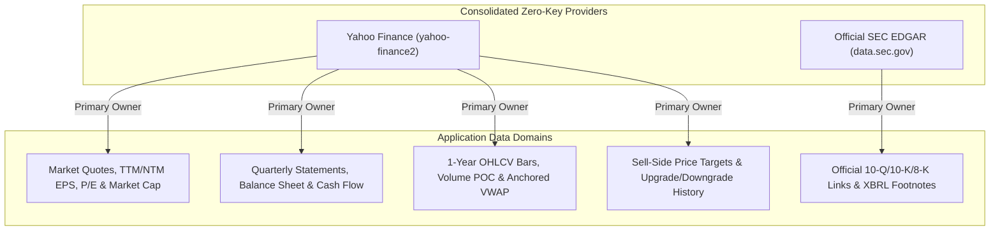

# Data Ingestion Telemetry & Rate-Limit (TPS) Architecture

> **Document Version:** 2.0.0  
> **Status:** Active / Production Standard  
> **Target Services:** Yahoo Finance (`yahoo-finance2`), Official SEC EDGAR (`data.sec.gov`), Neon PostgreSQL  
> **Last Updated:** November 2026  

---

## 1. Executive Summary & Objective

In high-throughput financial pipelines, **redundant multi-vendor querying** degrades performance, exhausts paid/free API rate quotas, and introduces data drift between mismatched denominators (e.g. real-time market price paired with stale share count).

StressAlpha consolidates all market and fundamental ingestion into a **Zero-Key Single-Ownership Model** powered by **`yahoo-finance2`** and official **`SEC EDGAR`** (`data.sec.gov`) APIs.

---

## 2. External Provider Rate-Limit Ceilings

| Provider | Authentication | Rate Limit Ceiling | Enforcement & Mitigation |
| :--- | :--- | :--- | :--- |
| **SEC EDGAR (`data.sec.gov`)** | Declared `User-Agent` header | **10.0 TPS** (10 req/sec) | Government firewall; enforced via `resilientFetch` and cached CIK directory (`secCikMapCache`) |
| **Yahoo Finance (`yahoo-finance2`)** | Zero-key client | **~2–5 TPS** sustained | Batch-chunked (50 tickers/call in `sync_prices.ts`) and paced (`2,200ms` delay in `bulk_scaffold.ts`) |
| **Finnhub.io (Optional)** | `FINNHUB_API_KEY` | **1.0 TPS** (60 req/min) | Optional calendar discovery only; automatically falls back to `fetchYahooEarningsCalendar` when omitted |

---

## 3. Single-Ownership Domain Matrix

1. **Market Quotes, Multiples & Capitalization**:
   - **Owner**: `yahoo-finance2` (`quote` & `quoteSummary`), syncing `currentPrice`, `previousClose`, `trailingEps`, `forwardEps`, `trailingPe`, `forwardPe`, and `marketCap`.
2. **Quarterly Financial Statements, Balance Sheet & Cash Flows**:
   - **Owner**: `yahoo-finance2` (`fundamentalsTimeSeries` & `financialData`), normalized into `FinancialProfile.quarterlyStatements` and `financial_metrics`.
3. **1-Year Technical Corridors & Post-Earnings Reactions**:
   - **Owner**: `yahoo-finance2` (`chart` 1d bars), feeding `computeTechnicalLevels` (Volume Profile POC, Anchored VWAPs, Pivot Extensions).
4. **Analyst Consensus & Broker Upgrades/Downgrades**:
   - **Owner**: `yahoo-finance2` (`recommendationTrend`, `upgradeDowngradeHistory`, `financialData` targets).
5. **Official Regulatory Filings & XBRL Footnotes**:
   - **Owner**: Official SEC EDGAR (`https://data.sec.gov/submissions/CIK{cik}.json` & XBRL companyfacts).

---

## 4. Pipeline Throughput & Rate-Budgeting Guidelines

| Workflow | Execution Pattern | Outbound Calls | Pacing & Safety |
| :--- | :--- | :--- | :--- |
| **Single-Ticker Scaffold (`fetchCompletePipelineBundle`)** | Parallel `Promise.all` across Yahoo Finance + SEC EDGAR | ~5 requests | Completes in `~650ms` |
| **Nightly Universe Price Sync (`scripts/sync_prices.ts`)** | Batch `yf.quote()` in 50-ticker chunks across 521 equities | ~11 batch requests | Completes in `<10s` |
| **Bulk Universe Scaffolding (`scripts/bulk_scaffold.ts`)** | Sequential ticker loop with `DEFAULT_PULL_DELAY_MS` | ~4–5 req/ticker | `2,200ms` inter-ticker delay (~1.3 TPS) |
| **Web Client Page Loads (`GET /:ticker`)** | Served 100% from Neon PostgreSQL + 4-Tier Cache | **0 external calls** | `<45ms` TTFB globally |
