# StressAlpha — System Architecture Documentation

> **Document Version:** 1.3.0  
> **Status:** Active / Production Baseline  
> **Target Framework:** Next.js 16 (App Router), React 19, TypeScript 5.5, Neon PostgreSQL, Drizzle ORM  
> **Test Coverage:** 244 automated unit & integration tests across 24 test suites (100% passing)  
> **Last Updated:** October 2026  

---

## 1. Executive Summary & Core Philosophy

**StressAlpha** is an institutional equity earnings analysis and deterministic scenario stress-testing platform. It bridges the gap between raw corporate financial filings (SEC 10-Q/8-K, earnings call transcripts) and real-time investment committee decision-making.

### Architectural Tenets
1. **Zero LLM Math Hallucinations**: Large Language Models are used exclusively for qualitative context extraction and forensic auditing (e.g. governance flags, accounting risk excerpts). All financial arithmetic, operating leverage flows, regime probability distributions (via QPCE), valuation bands, and risk asymmetry skews are computed by pure deterministic TypeScript engines (`src/lib/valuation.ts`, `src/lib/snowflake.ts`).
2. **Audited SEC Data Extraction & Financial Feeds**: Extract facts directly from SEC 10-K / 10-Q filings, press releases, and earnings call transcripts via **Massive.com** (point-in-time statements and ratios) and **Finnhub.io** (audio transcripts, SEC filings, consensus targets, and earnings calendar).
3. **Event-Driven Fundamental Transmission**: Real-time market news and corporate announcements are filtered for clickbait and legal solicitations, then converted into typed fundamental transmission vectors (driver shocks, segment growth, consensus skews) that flow deterministically into valuation models without AI price speculation.
4. **Autonomous Earnings Calendar Scaffolding**: An inverted daily polling model queries Finnhub's earnings calendar twice daily (post-BMO and post-AMC), auto-scaffolding complete bilingual 8-module report models, computing valuations, and logging sanity audits into Neon PostgreSQL.
5. **Strict Zod Contract Validation**: Every piece of incoming data is validated against strongly-typed Zod schemas (`src/lib/schemas.ts`). Malformed inputs fail fast before reaching the valuation engine or presentation layer.
6. **Sub-Millisecond Client-Side Simulation**: Once a report payload is loaded into the browser, all sensitivity sliders (upstream demand shocks, gross margin shifts, fixed OpEx elasticity) execute client-side at `<1ms` latency without round-trip network overhead.
7. **Isolated Ephemeral Integration Testing**: Vitest integration tests run against copy-on-write database branches spun up from production Neon PostgreSQL in ~0.85s, providing 100% cloud parity without polluting production data.

---

## 2. High-Level Architecture Diagram

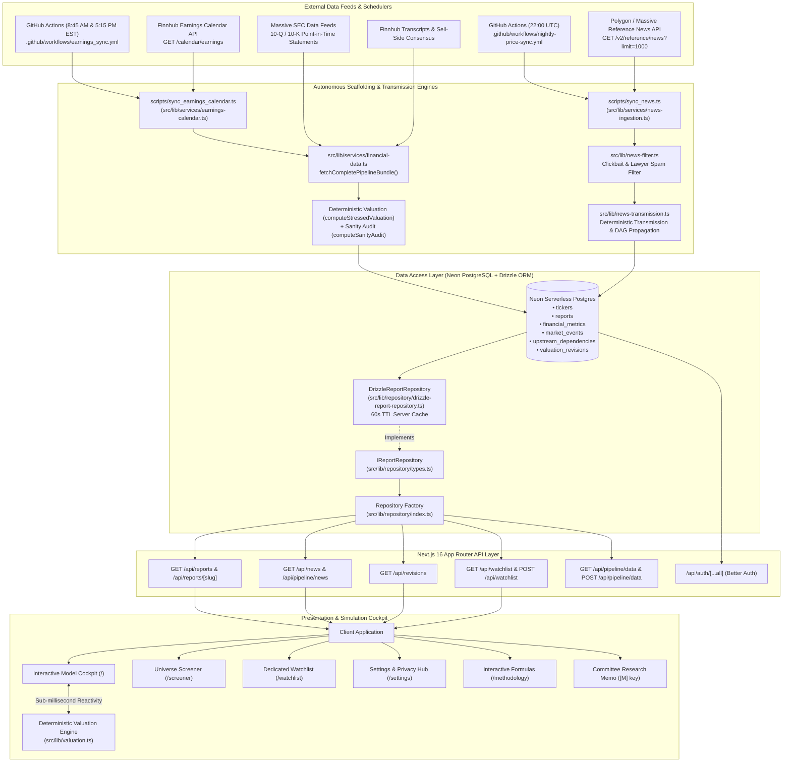

---

## 3. UI Architecture & Desktop Dual-Pane Independent Scroll

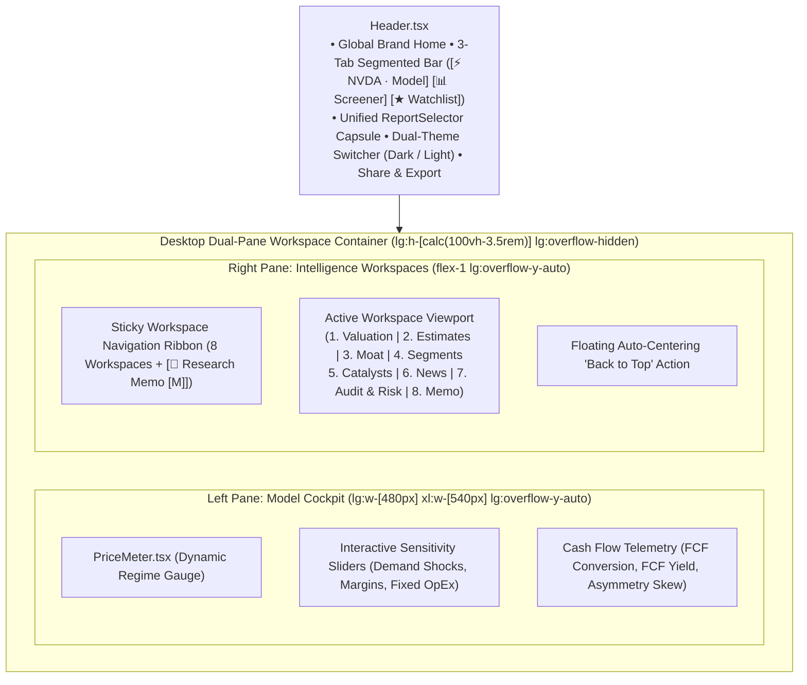

### Visual Verification: Desktop Cockpit & Navigation
The left model pane stays permanently anchored during simulation, while the right intelligence pane scrolls independently through 10-Q risk factors, consensus tables, and market events:

<p align="center">
  
</p>

### Universe Screener & Multi-Ticker Radar View
Dedicated `/screener` route with dual-view modes (interactive cards for mobile, structured tables for desktop), displaying real-time 30-point Snowflake Radars and valuation regime spreads:

<p align="center">
  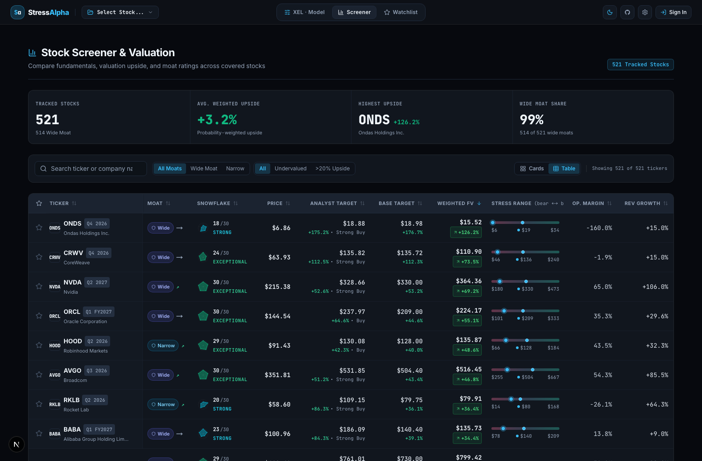
</p>

### Dedicated Watchlist Portfolio
Dedicated `/watchlist` route grouping coverage universe constituents by report quarter, with key valuation spreads and operating margins:

<p align="center">
  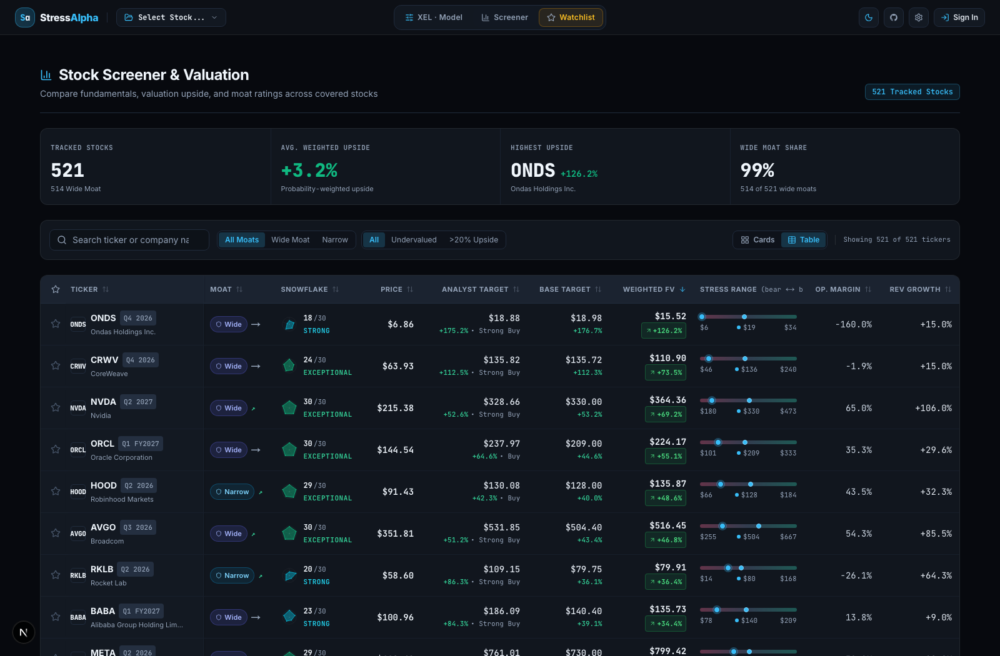
</p>

---

## 4. Data Layer Architecture & Ephemeral Cloud Parity

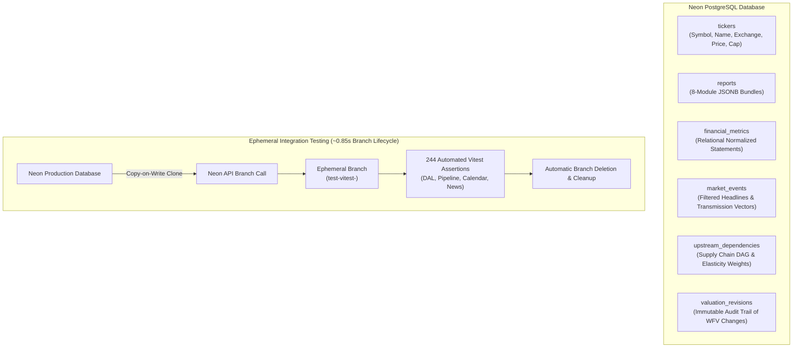

### 4.1 Neon PostgreSQL Schema (`src/db/schema.ts`)

| Table | Purpose & Key Schema Columns |
| :--- | :--- |
| `tickers` | Master equity universe. Ticker, company name, exchange, sector, live `currentPrice`, `marketCapBillions`, and `lastPriceSync`. |
| `reports` | 8-module quarterly analysis bundles. Ticker, quarter slug (`nvda-2027q1`), `reportDate`, and JSONB columns for `facts`, `scenarios`, `valuation`, `baseline`, `moat`, `estimates`, `catalysts`, `sentiment`, `filings`, and `reactions`. |
| `financial_metrics` | Normalized relational time-series statement metrics decomposed from quarterly filings. Composite indexed on `(ticker, fiscalYear, fiscalQuarter)`. Stores Revenue, Gross Profit, Operating Income, Net Income, OCF, FCF, CapEx, Diluted EPS, and Margins. |
| `market_events` | Ingested and filtered market events. Ticker, headline, source URL, event category (`earnings_guidance`, `supply_chain`, `capex_driver`, `regulatory`), abnormal return, and mapped transmission vector. |
| `upstream_dependencies` | Directed supply chain graph. `sourceTicker` (e.g. `TSM`), `targetTicker` (e.g. `NVDA`), dependency type, and elasticity weight. |
| `valuation_revisions` | Immutable valuation audit trail. Ticker, trigger type (`quarterly_filing`, `market_event`, `manual_audit`), prior WFV, new WFV, delta percentage, and rationale. |
| `users`, `sessions`, `accounts`, `verifications` | Better Auth authentication and session management. |

### 4.2 The Income Quality Guardrail
StressAlpha isolates non-operating accounting anomalies in `facts.json` to compute normalized **Operating EPS**:
- **ASU 2016-01 Normalization**: Mark-to-market unrealized paper gains on equity securities (e.g. Amazon's $53.4B Anthropic valuation mark in Q2 2026) are stripped out of Reported Diluted EPS.
- The deterministic valuation engine strictly defaults to operating earnings to prevent artificial multiple distortion.

### 4.3 Data Access Layer (DAL) Pattern
All data access in Next.js routes and scripts is mediated through `IReportRepository`:

```typescript
export interface IReportRepository {
  listReports(): Promise<ReportSummary[]>;
  getReport(folderSlug: string): Promise<ReportData | null>;
  saveReport(report: ReportData): Promise<void>;
  deleteReport(folderSlug: string): Promise<void>;
  syncPrice(ticker: string, price: number): Promise<void>;
  getMarketEvents(ticker: string, limit?: number): Promise<MarketEventRecord[]>;
  saveMarketEvent(event: NewMarketEvent): Promise<void>;
  getValuationRevisions(ticker: string): Promise<ValuationRevisionRecord[]>;
  recordValuationRevision(revision: NewValuationRevision): Promise<void>;
  getFinancialMetrics(ticker: string): Promise<FinancialMetric[]>;
  saveFinancialMetrics(metrics: FinancialMetricsInsert[]): Promise<void>;
}
```

* **`DrizzleReportRepository`**: Connected directly to Neon Serverless PostgreSQL with a 60-second in-memory server cache and client-side memory caching, delivering <5ms response times.
* **`InMemoryReportRepository`**: Complete mock implementation for fast, fully isolated unit testing without external database dependencies.

---

## 5. Computational Valuation Engine (`src/lib/valuation.ts`)

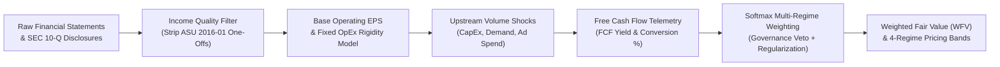

The arithmetic engine runs identically in two contexts:
1. **Server / CLI**: Executed during report compilation and autonomous earnings calendar scaffolding.
2. **Client Browser**: Executed inside `src/components/Cockpit.tsx` whenever a user adjusts a sensitivity slider (<1ms response time).

### 5.1 Sensitivity Shock Propagation Equations

1. **Top-Line Demand Shock**:
   $$\Delta \text{Revenue} = \text{Base Revenue} \times \sum_{i} \left( \text{Exposure}_i \times \text{Elasticity}_i \times \text{Shock}_i \right)$$
   Where $i \in \{\text{Hyperscaler CapEx}, \text{Consumer Demand}, \text{Digital Ad Spend}\}$.

2. **Operating Leverage & Margins**:
   $$\text{Stressed Gross Profit} = \text{Stressed Revenue} \times (\text{Gross Margin}_{\text{base}} + \Delta \text{Margin}_{\text{bps}})$$
   $$\text{Stressed OpEx} = \text{Fixed OpEx}_{\text{base}} \times (1 + \Delta \text{FixedOpEx}_{\%}) + \text{Variable OpEx}$$
   $$\text{Stressed Operating Income} = \text{Stressed Gross Profit} - \text{Stressed OpEx}$$
   $$\text{Stressed Free Cash Flow} = \text{Stressed Operating Income} \times (1 - \text{Tax Rate}) + \text{D\&A} - \text{CapEx}$$
   $$\text{FCF Conversion } \% = \frac{\text{Stressed Free Cash Flow}}{\text{Stressed Net Income}} \times 100$$
   $$\text{FCF Yield } \% = \frac{\text{FCF Per Share}}{\text{Current Price}} \times 100$$

3. **Stressed Diluted EPS**:
   $$\text{Stressed EPS} = \frac{\text{Stressed Net Income}}{\text{Diluted Shares Outstanding}}$$

4. **Risk / Reward Asymmetry Skew**:
   $$\text{Asymmetry Skew} = \frac{\text{Bull Fair Value} - \text{Current Price}}{\text{Current Price} - \text{Panic Fair Value}}$$

### 5.2 Deterministic Scenario Calibration Matrix & Archetypes

To replace naive symmetrical priors (e.g. 25/50/25) with transparent deterministic scenario probabilities, StressAlpha applies **Softmax Multi-Regime Weighting with Tail Risk Heuristics** in log-odds space:

1. **Log-Odds Transformation**: $z_i = \ln(p_i)$ for $i \in \{\text{Bull}, \text{Base}, \text{Bear}, \text{Panic}\}$.
2. **Deterministic Perturbation**: $z_i' = z_i + \Delta z_i^{\text{gov}} + \Delta z_i^{\text{archetype}} + \Delta z_i^{\text{consensus}} + \Delta z_i^{\text{mkt}}$.
3. **Softmax ($T = 1.0$)**: $p_i' = \frac{\exp(z_i')}{\sum_{j} \exp(z_j')}$.
4. **Simplex Bounding ($\epsilon = 0.05$)**: $p_i \in [0.05, 0.85]$ and $\sum_{i} p_i \equiv 1.000$.

#### The 4 Institutional Calibration Pillars
1. **Pillar 1: Forensic & Governance Tail Veto**: Severe governance risk, auditor resignations, or DOJ investigations trigger asymmetric log-odds shifts ($\Delta z_{\text{panic}} = +1.35, \Delta z_{\text{bull}} = -1.60$) and a lexicographic override capping Bull ($\le 8\%$) and flooring Panic ($\ge 45\%$), preventing high gross margins from masking accounting fraud (*Wirecard/Enron guardrail*).
2. **Pillar 2: Archetype-Aware Resilience & Capital Runway**:
   - `compounder` (Archetype A): Operating margin $>30\%$ rewarded; $<15\%$ penalized unless protected by durable Wide Moat (*Costco Compounder Exemption*).
   - `operating_scaler` (Archetype B): Fast growth ($\ge 25\%$), high gross margins ($\ge 60\%$) rewarded for operating leverage velocity.
   - `venture_hypergrowth` (Archetype C): Scale-up innovators ($\ge 50\%$ growth, negative operating margin). Must satisfy gross margin floor ($\ge 35\%$) to waive operating margin penalties (*Unit Economics Exemption*). Audits Net Liquid Runway ($\tau_{\text{net}} = (\text{cash} - \text{short-term debt}) / \text{monthly burn}$): $<9$ months triggers acute dilution penalty ($\Delta z_{\text{panic}} = +1.25, \Delta z_{\text{bull}} = -1.10$).
3. **Pillar 3: Wall Street Consensus Skew & Dispersion**: Calibrates consensus buy/hold/sell ratios and price target dispersion into tail probabilities.
4. **Pillar 4: Market-Implied Risk Anchor & Regularization**: Reverse-engineers market-priced-in disaster risk with a 20% dampening regularization weight ($w_{\text{mkt}} = 0.20$), anchoring against extreme divergence without losing fundamental alpha discovery.

<p align="center">
  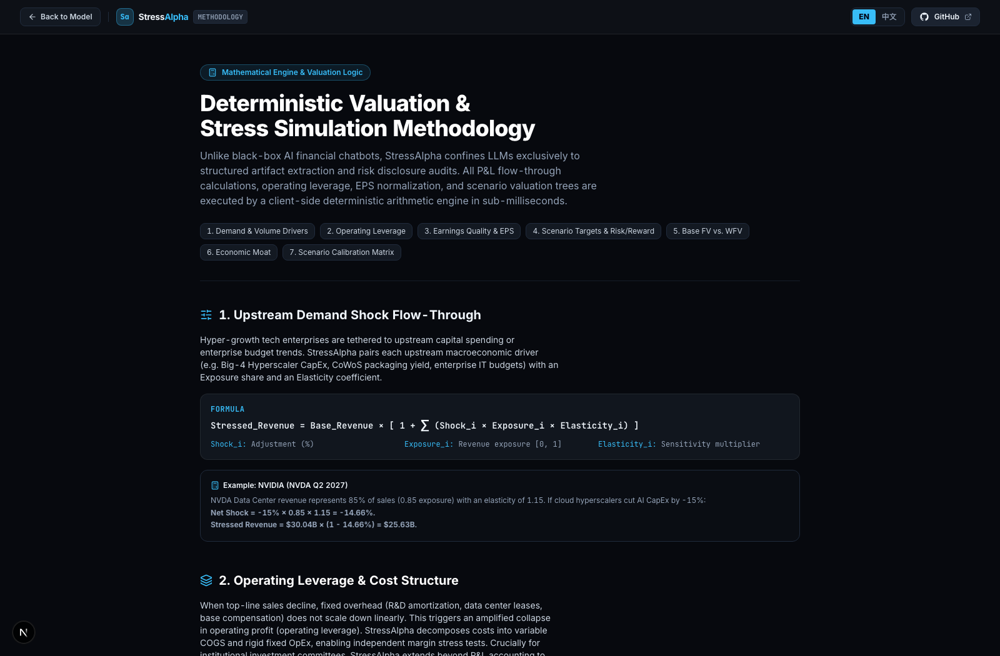
</p>

---

## 6. Event-Driven News & Transmission Pipeline

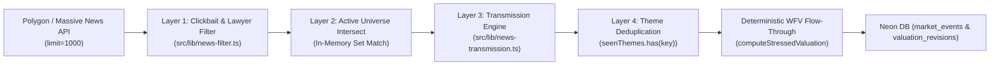

1. **Materiality & Spam Filtering (`src/lib/news-filter.ts`)**: Rejects ~90% of wire syndication spam, rhetorical questions, and class-action lawsuit solicitations with 0 LLM cost.
2. **Deterministic Transmission Engine (`src/lib/news-transmission.ts`)**: Maps qualitative events into typed quantitative vectors (`driver_shock`, `catalyst_prob`, `qpce_skew`, `segment_growth`). Pure TypeScript recalculates implied fair value delta with zero LLM math.
3. **Cross-Company DAG Propagation**: Propagates upstream announcements (e.g. ASML/TSMC wafer bookings) to downstream customers (e.g. NVIDIA revenue) via `upstream_dependencies`.

---

## 7. Inverted Earnings Calendar & Autonomous Scaffolding

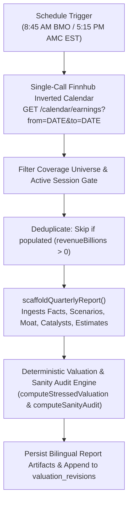

1. **Inverted Calendar Polling**: Ingests reporting companies for target dates via Finnhub (`GET /calendar/earnings`) in a single query rather than polling individual tickers.
2. **Session Splitting & Timing**:
   - `bmo` (Before Market Open): Scaffolding triggered at **8:45 AM EST**.
   - `amc` (After Market Close): Scaffolding triggered at **5:15 PM EST**.
   - Timing accounts for the 5–20 minute XBRL statement normalization delay by SEC aggregators.
3. **Deduplication**: Verifies if the report already exists in Neon DB with populated statements (`revenueBillions > 0`). Skips populated reports to avoid redundant work unless forced with `--force`.
4. **Deterministic Scaffolding**: Automatically fetches point-in-time statements, price targets, guidance, and filings, scaffolding all 8 quarterly modules in both English and Chinese, running `computeStressedValuation` and `computeSanityAudit`, and appending a baseline snapshot to `valuation_revisions`.

---

## 8. Printable Committee Memorandum (`[M]` key)

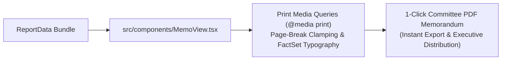

<p align="center">
  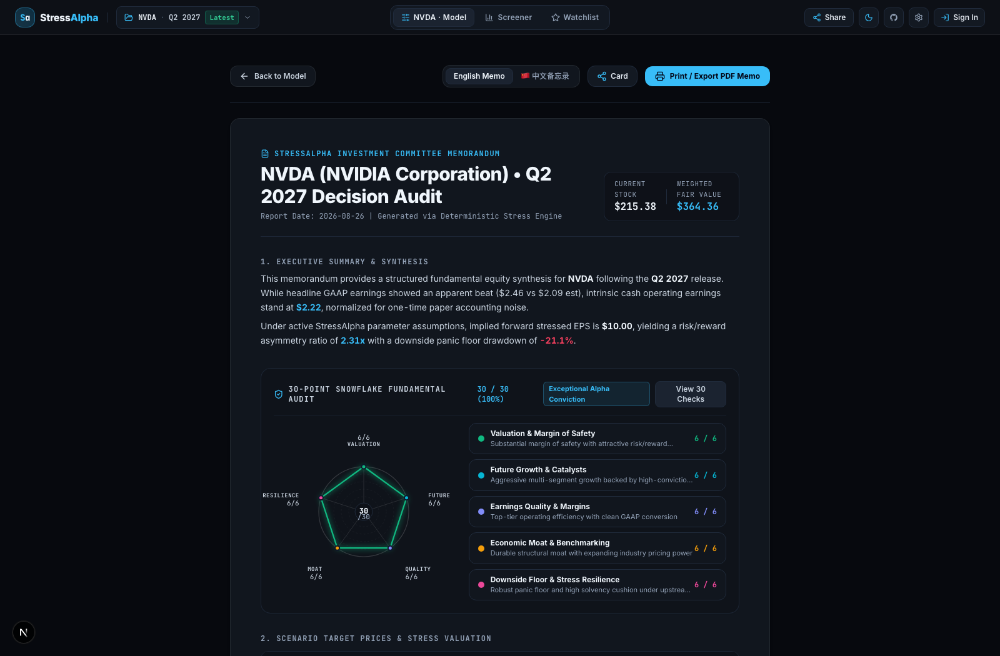
</p>

---

## 9. Verification & Continuous Integration

Every commit is gated by a 5-stage verification pipeline in `.husky/pre-push` and GitHub Actions (`.github/workflows/ci.yml`):

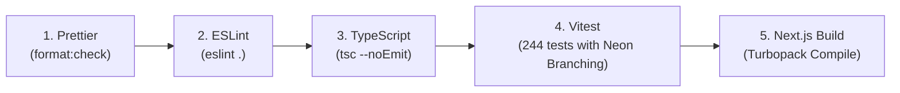

1. **Prettier Formatting**: `npm run format:check`
2. **ESLint Linting**: `npm run lint`
3. **TypeScript Static Analysis**: `npx tsc --noEmit` (0 errors)
4. **Vitest Unit Test Suite**: `npm test` (244 tests across 24 suites)
5. **Next.js Production Build**: `npm run build` (Turbopack compilation)
