# StressAlpha — System Architecture Documentation

> **Document Version:** 1.5.0  
> **Status:** Active / Production Baseline  
> **Target Framework:** Next.js 16 (App Router), React 19, TypeScript 5.5, Neon PostgreSQL, Drizzle ORM  
> **Test Coverage:** 320 automated unit & integration tests across 32 test suites (100% passing)  
> **Last Updated:** November 2026  

---

## 1. Executive Summary & Core Philosophy

**StressAlpha** is an institutional equity earnings analysis and deterministic scenario stress-testing platform. It bridges the gap between raw corporate financial filings (SEC 10-Q/10-K/8-K, earnings call transcripts) and real-time investment committee decision-making.

### Architectural Tenets
1. **Zero LLM Math Hallucinations**: Large Language Models are used exclusively for qualitative context extraction and forensic auditing (e.g. governance flags, accounting risk excerpts). All financial arithmetic, operating leverage flows, regime probability distributions (via QPCE), valuation bands, and risk asymmetry skews are computed by pure deterministic TypeScript engines (`src/lib/valuation.ts`, `src/lib/snowflake.ts`).
2. **Zero Frontend Calculation Placeholders**: UI components never fabricate target prices, consensus spreads, or synthetic constituent returns. Unpopulated fields render `"—"` honestly, and Last Close P/E anchors directly to live market TTM/NTM EPS telemetry (`trailingEps`, `forwardEps`).
3. **Consolidated SEC EDGAR & Yahoo Finance Ingestion**: Financial statements, balance sheets, cash flows, 1-year OHLCV technical bars, and sell-side consensus estimates are ingested via **`yahoo-finance2`**, paired directly with official **`SEC EDGAR`** (`data.sec.gov`) regulatory submissions and XBRL footnotes—requiring zero paid third-party market data keys.
4. **Autonomous Earnings Calendar Scaffolding**: Scheduled twice daily (8:45 AM & 5:15 PM EST), the earnings sync engine queries upcoming/reporting companies across the S&P 500 and NASDAQ-100, auto-scaffolding complete bilingual 8-module report models, computing valuations, and logging sanity audits into Neon PostgreSQL (`upcoming_earnings`, `reports`, `valuation_revisions`).
5. **Strict Zod Contract Validation**: Every piece of incoming data is validated against strongly-typed Zod schemas (`src/lib/schemas.ts`). Malformed inputs fail fast before reaching the valuation engine or presentation layer.
6. **Sub-Millisecond Client-Side Simulation**: Once a report payload is loaded into the browser, all sensitivity sliders (upstream demand shocks, gross margin shifts, fixed OpEx elasticity) execute client-side at `<1ms` latency without round-trip network overhead.
7. **Isolated Ephemeral Integration Testing**: Vitest integration tests run against copy-on-write database branches spun up from production Neon PostgreSQL in ~1.0s, providing 100% cloud parity without polluting production data.

---

## 2. High-Level Architecture Diagram

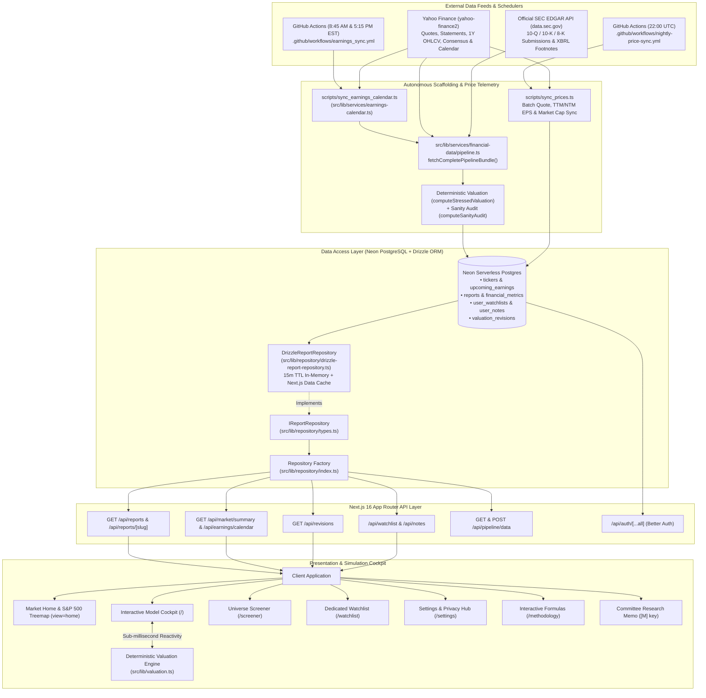

---

## 3. UI Architecture & Desktop Dual-Pane Independent Scroll

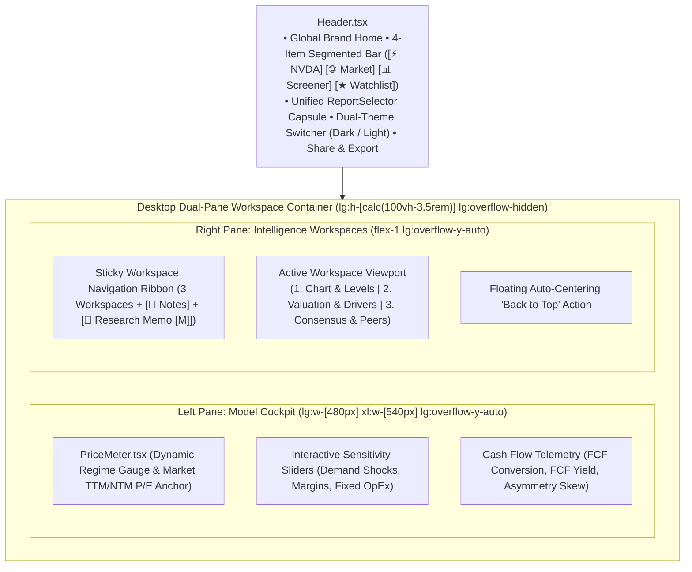

### Visual Verification: Desktop Cockpit & Navigation
The left model pane stays permanently anchored during simulation, while the right intelligence pane scrolls independently through 10-Q risk factors, consensus tables, and market events:

<p align="center">
  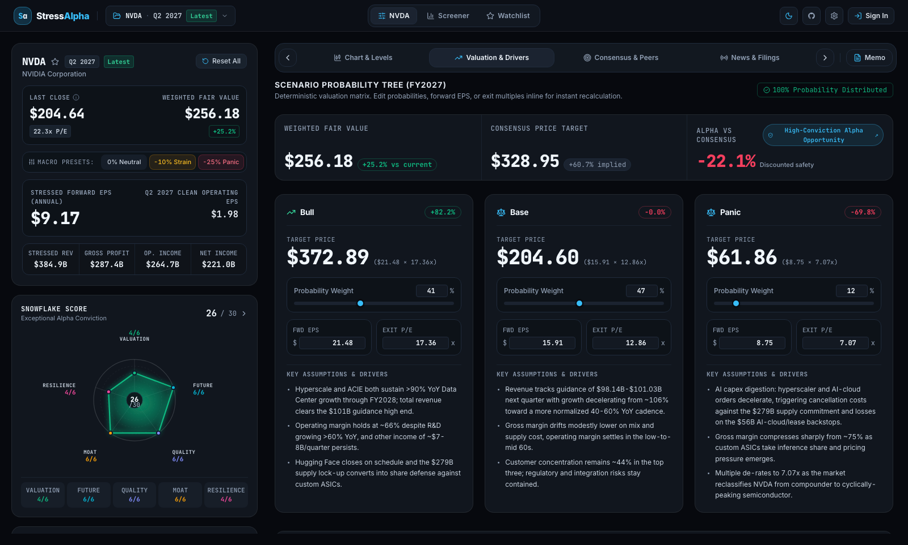
</p>

### Universe Screener & Multi-Ticker Radar View
Dedicated `/screener` route with dual-view modes (interactive cards for mobile, structured tables for desktop), displaying real-time 30-point Snowflake Radars and valuation regime spreads:

<p align="center">
  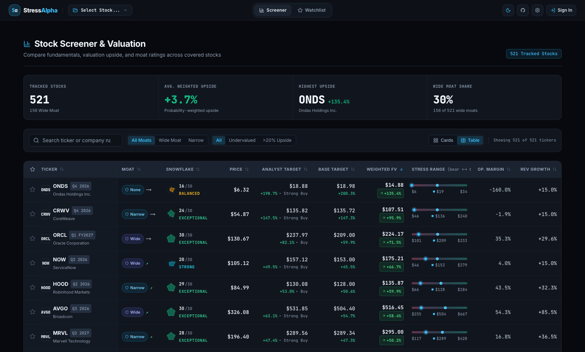
</p>

### Dedicated Watchlist Portfolio
Dedicated `/watchlist` route grouping coverage universe constituents into deep-dive cards and matrix table layouts, tracking sell-side variant perception, 4-regime valuation bounds, and 5-pillar Snowflake health breakdowns:

<p align="center">
  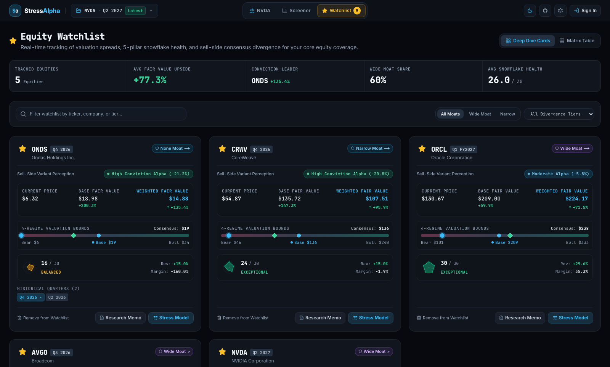
</p>

### 3.1 Design System, Dual-Theme Engine & Institutional Privacy
* **Dual Themes**: Default Bloomberg Terminal Dark (`#07090e`) and FactSet/WSJ Day Light (`#f8fafc`) with zero-flash (0ms FOUC) SSR persistence via `src/components/ThemeScript.tsx`.
* **Zero-Exposure Email Privacy**: User emails are omitted from header menus and mobile drawers, and masked by default on `/settings` to safeguard against shoulder-surfing and presentation leaks.
* **Desktop Dual-Pane Independent Scroll**: Locked window scroll on desktop (`lg:overflow-hidden`) eliminates jumpy double scrollbars; left model and right deep-dive workspaces scroll independently.

---

## 4. Data Layer Architecture & Ephemeral Cloud Parity

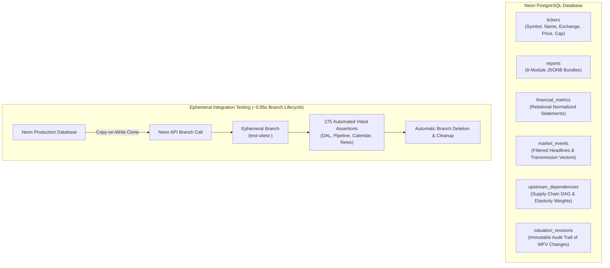

### 4.1 Neon PostgreSQL Schema (`src/db/schema.ts`)

| Table | Purpose & Key Schema Columns |
| :--- | :--- |
| `tickers` | Master equity universe. Ticker, company name, sector, live `currentPrice`, `previousClose`, `marketCap`, `trailingEps`, `forwardEps`, `trailingPe`, `forwardPe`, `technicalLevels`, and `priceUpdatedAt`. |
| `reports` | 8-module quarterly analysis bundles. Ticker, quarter slug (`nvda-2027q1`), `reportDate`, denormalized Snowflake/fair-value metrics, and JSONB columns for `facts`, `scenarios`, `valuation`, `baseline`, `moat`, `estimates`, `catalysts`, `sentiment`, `filing`, and `reactions` (plus `*_zh` counterparts). |
| `financial_metrics` | Normalized relational time-series statement metrics decomposed from quarterly filings. Composite indexed on `(ticker, fiscalYear, fiscalQuarter)`. Stores Revenue, Gross Profit, Operating Income, Net Income, OCF, FCF, CapEx, Diluted EPS, and Margins. |
| `upcoming_earnings` | 14-day forward S&P 500 & NASDAQ-100 earnings calendar docket (`symbol`, `date`, `hour` (`bmo`/`amc`), `epsEstimate`, `revenueEstimate`, `hasModel`, `reportSlug`, `sectorId`). |
| `user_watchlists` | Cloud-synchronized ticker watchlists per authenticated user. Composite indexed on `(userId, ticker)` with deletion cascading. |
| `user_notes` | Cloud-synchronized per-stock analyst notes (`id: ${userId}_${ticker}`, `content`, `updatedAt`), mirrored in `localStorage` for instant offline/guest editing and rendered inside research memos. |
| `valuation_revisions` | Immutable valuation audit trail. Ticker, trigger type (`quarterly_filing`, `market_event`, `manual_audit`), prior WFV, new WFV, delta percentage, and rationale. |
| `market_events` & `upstream_dependencies` | Event transmission ledger and directed supply-chain dependency graph (`sourceTicker` $\to$ `targetTicker`, exposure share, and elasticity weight). |
| `user`, `session`, `account`, `verification` | Better Auth authentication and session management. |

### 4.2 The Income Quality Guardrail
StressAlpha isolates non-operating accounting anomalies in `facts.json` to compute normalized **Operating EPS**:
- **ASU 2016-01 Normalization**: Mark-to-market unrealized paper gains on equity securities (e.g. Amazon's $53.4B Anthropic valuation mark in Q2 2026) are stripped out of Reported Diluted EPS.
- The deterministic valuation engine strictly defaults to operating earnings to prevent artificial multiple distortion.

### 4.3 Data Access Layer (DAL) Pattern
All data access in Next.js routes and scripts is mediated through `IReportRepository`:

```typescript
export interface IReportRepository {
  listReports(): Promise<ReportSummary[]>;
  getReport(folderSlug: string): Promise<ReportData | null>;
  saveReport(report: ReportData): Promise<void>;
  deleteReport(folderSlug: string): Promise<void>;
  syncPrice(ticker: string, price: number): Promise<void>;
  getMarketEvents(ticker: string, limit?: number): Promise<MarketEventRecord[]>;
  saveMarketEvent(event: NewMarketEvent): Promise<void>;
  getValuationRevisions(ticker: string): Promise<ValuationRevisionRecord[]>;
  recordValuationRevision(revision: NewValuationRevision): Promise<void>;
  getFinancialMetrics(ticker: string): Promise<FinancialMetric[]>;
  saveFinancialMetrics(metrics: FinancialMetricsInsert[]): Promise<void>;
}
```

* **`DrizzleReportRepository`**: Connected directly to Neon Serverless PostgreSQL (`us-west-2`), projecting scalar JSONB fields directly in SQL (`estimates->'priceTargets'->>'average'`, etc.) to minimize network egress (~380 KB for 640+ reports). Shielded by a 4-tier caching hierarchy:
  1. **Level 1 (Browser & TanStack Query)**: 5-minute browser disk cache (`max-age=300`) and 30-minute React Query `staleTime` (`gcTime=60m`).
  2. **Level 2 (Vercel US Edge CDN)**: 1-hour Edge POP cache (`s-maxage=3600, stale-while-revalidate=86400`) across read endpoints.
  3. **Level 3 (Next.js Data Cache & `pdx1` Co-location)**: Serverless compute pinned to `pdx1` (`us-west-2` in `vercel.json`) with `unstable_cache` and automatic `revalidateTag("reports", "max")` invalidation on pipeline mutations.
  4. **Level 4 (Warm Lambda In-Memory Shield)**: 15-minute in-memory repository cache (`CACHE_TTL_MS = 900_000`), delivering <1ms warm hits.
* **`InMemoryReportRepository`**: Complete mock implementation for fast, fully isolated unit testing without external database dependencies.

---

## 5. Computational Valuation Engine (`src/lib/valuation.ts`)

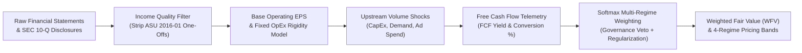

The arithmetic engine runs identically in two contexts:
1. **Server / CLI**: Executed during report compilation and autonomous earnings calendar scaffolding.
2. **Client Browser**: Executed inside `src/components/Cockpit.tsx` whenever a user adjusts a sensitivity slider (<1ms response time).

### 5.1 Sensitivity Shock Propagation Equations

1. **Top-Line Demand Shock**:
   $$\Delta \text{Revenue} = \text{Base Revenue} \times \sum_{i} \left( \text{Exposure}_i \times \text{Elasticity}_i \times \text{Shock}_i \right)$$
   Where $i \in \{\text{Hyperscaler CapEx}, \text{Consumer Demand}, \text{Digital Ad Spend}\}$.

2. **Operating Leverage & Margins**:
   $$\text{Stressed Gross Profit} = \text{Stressed Revenue} \times (\text{Gross Margin}_{\text{base}} + \Delta \text{Margin}_{\text{bps}})$$
   $$\text{Stressed OpEx} = \text{Fixed OpEx}_{\text{base}} \times (1 + \Delta \text{FixedOpEx}_{\%}) + \text{Variable OpEx}$$
   $$\text{Stressed Operating Income} = \text{Stressed Gross Profit} - \text{Stressed OpEx}$$
   $$\text{Stressed Free Cash Flow} = \text{Stressed Operating Income} \times (1 - \text{Tax Rate}) + \text{D\&A} - \text{CapEx}$$
   $$\text{FCF Conversion } \% = \frac{\text{Stressed Free Cash Flow}}{\text{Stressed Net Income}} \times 100$$
   $$\text{FCF Yield } \% = \frac{\text{FCF Per Share}}{\text{Current Price}} \times 100$$

3. **Stressed Diluted EPS**:
   $$\text{Stressed EPS} = \frac{\text{Stressed Net Income}}{\text{Diluted Shares Outstanding}}$$

4. **Risk / Reward Asymmetry Skew**:
   $$\text{Asymmetry Skew} = \frac{\text{Bull Fair Value} - \text{Current Price}}{\text{Current Price} - \text{Panic Fair Value}}$$

### 5.2 Deterministic Scenario Calibration Matrix & Archetypes

To replace naive symmetrical priors (e.g. 25/50/25) with transparent deterministic scenario probabilities, StressAlpha applies **Softmax Multi-Regime Weighting with Tail Risk Heuristics** in log-odds space:

1. **Log-Odds Transformation**: $z_i = \ln(p_i)$ for $i \in \{\text{Bull}, \text{Base}, \text{Bear}, \text{Panic}\}$.
2. **Deterministic Perturbation**: $z_i' = z_i + \Delta z_i^{\text{gov}} + \Delta z_i^{\text{archetype}} + \Delta z_i^{\text{consensus}} + \Delta z_i^{\text{mkt}}$.
3. **Softmax ($T = 1.0$)**: $p_i' = \frac{\exp(z_i')}{\sum_{j} \exp(z_j')}$.
4. **Simplex Bounding ($\epsilon = 0.05$)**: $p_i \in [0.05, 0.85]$ and $\sum_{i} p_i \equiv 1.000$.

#### The 4 Institutional Calibration Pillars
1. **Pillar 1: Forensic & Governance Tail Veto**: Severe governance risk, auditor resignations, or DOJ investigations trigger asymmetric log-odds shifts ($\Delta z_{\text{panic}} = +1.35, \Delta z_{\text{bull}} = -1.60$) and a lexicographic override capping Bull ($\le 8\%$) and flooring Panic ($\ge 45\%$), preventing high gross margins from masking accounting fraud (*Wirecard/Enron guardrail*).
2. **Pillar 2: Archetype-Aware Resilience & Capital Runway**:
   - `compounder` (Archetype A): Operating margin $>30\%$ rewarded; $<15\%$ penalized unless protected by durable Wide Moat (*Costco Compounder Exemption*).
   - `operating_scaler` (Archetype B): Fast growth ($\ge 25\%$), high gross margins ($\ge 60\%$) rewarded for operating leverage velocity.
   - `venture_hypergrowth` (Archetype C): Scale-up innovators ($\ge 50\%$ growth, negative operating margin). Must satisfy gross margin floor ($\ge 35\%$) to waive operating margin penalties (*Unit Economics Exemption*). Audits Net Liquid Runway ($\tau_{\text{net}} = (\text{cash} - \text{short-term debt}) / \text{monthly burn}$): $<9$ months triggers acute dilution penalty ($\Delta z_{\text{panic}} = +1.25, \Delta z_{\text{bull}} = -1.10$).
3. **Pillar 3: Wall Street Consensus Skew & Dispersion**: Calibrates consensus buy/hold/sell ratios and price target dispersion into tail probabilities.
4. **Pillar 4: Market-Implied Risk Anchor & Regularization**: Reverse-engineers market-priced-in disaster risk with a 20% dampening regularization weight ($w_{\text{mkt}} = 0.20$), anchoring against extreme divergence without losing fundamental alpha discovery.

<p align="center">
  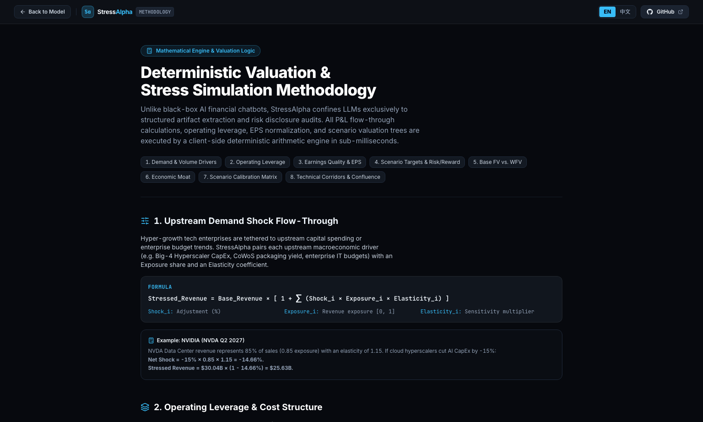
</p>

### Deterministic Technical Corridors & Confluence Engine (`src/lib/technical.ts`)
To bridge fundamental valuation models with institutional market microstructure without subjective chartist guessing:
1. **Classical Pivot Point Extensions**:
   - $P = (H + L + C) / 3$
   - $S_1 = 2P - H$, $R_1 = 2P - L$
   - $S_2 = P - (H - L)$, $R_2 = P + (H - L)$
   - Third-tier measured-move extensions: $S_3 = L - 2(H - P)$, $R_3 = H + 2(P - L)$
2. **Unfilled Gap Detection**:
   - Gaps $\ge 3\%$ between prior close and session bounds generate high-volume Gap Fill targets and day boundaries.
3. **1-Year Volume Profile POC & Anchored VWAPs**:
   - Discretizes 252-day price series into 40 equal-range volume buckets to isolate high-volume institutional nodes (POC).
   - Computes Anchored VWAPs from 52-Week High cycle peaks and highest volume trading sessions.
4. **Smart Clustering & 3-Tier Corridor Hierarchy**:
   - Levels within $\le 0.85\%$ distance merge into unified price zones.
   - Synthesizes into:
     - **Tier 1 (Immediate)**: Day-trader inventory boundaries ($S_1 / R_1$).
     - **Tier 2 (Structural)**: Multi-week congestion shelves, unfilled gap tops, and Volume POC ($S_2 / R_2$).
     - **Tier 3 (Macro)**: 52-week cycle extremes, 200-day SMA inflection, and measured breakdown extensions ($S_3 / R_3$).
5. **Regime Confluence Engine**:
   - Audits technical corridors against fundamental valuation regimes (Panic Floor, Bear Target, Base Target, Bull Target) within a $\pm 2.5\%$ tolerance band.
   - Detects high-conviction inflection zones (e.g. Volume POC converging with Base WFV within 0.2%).

---

## 6. Event-Driven News & Transmission Pipeline

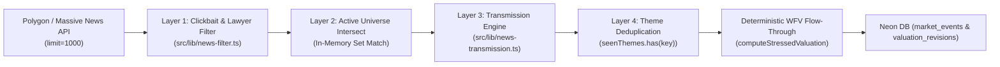

1. **Materiality & Spam Filtering (`src/lib/news-filter.ts`)**: Rejects ~90% of wire syndication spam, rhetorical questions, and class-action lawsuit solicitations with 0 LLM cost.
2. **Deterministic Transmission Engine (`src/lib/news-transmission.ts`)**: Maps qualitative events into typed quantitative vectors (`driver_shock`, `catalyst_prob`, `qpce_skew`, `segment_growth`). Pure TypeScript recalculates implied fair value delta with zero LLM math.
3. **Cross-Company DAG Propagation**: Propagates upstream announcements (e.g. ASML/TSMC wafer bookings) to downstream customers (e.g. NVIDIA revenue) via `upstream_dependencies`.

---

## 7. Autonomous Earnings Calendar & Zero-Key Data Scaffolding

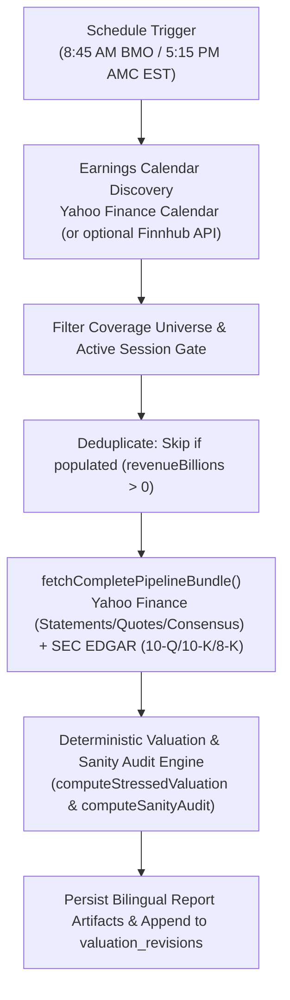

1. **Zero-Key Primary Ingestion**: Queries `yahoo-finance2` (`quote`, `quoteSummary`, `chart`, `fundamentalsTimeSeries`) for quarterly financial statements, balance sheets, cash flows, 1-year OHLCV technical corridors, and sell-side upgrades/downgrades, paired with official `data.sec.gov` submissions for 10-Q/10-K/8-K links and XBRL footnotes.
2. **Session Splitting & Timing**:
   - `bmo` (Before Market Open): Scaffolding triggered at **8:45 AM EST**.
   - `amc` (After Market Close): Scaffolding triggered at **5:15 PM EST**.
3. **Deduplication**: Verifies if the report already exists in Neon DB with populated statements (`revenueBillions > 0`). Skips populated reports to avoid redundant work unless forced with `--force`.
4. **Deterministic Scaffolding**: Automatically builds all 8 quarterly modules in both English and Chinese, runs `computeStressedValuation` and `computeSanityAudit`, updates `upcoming_earnings` docket status, and appends a baseline snapshot to `valuation_revisions`.
5. **Vercel AI Gateway Single-Pass Enrichment**: Consolidates qualitative synthesis into a single high-throughput pass across filing/sentiment and moat/scenarios when `AI_GATEWAY_API_KEY` is configured.

---

## 8. Printable Committee Memorandum (`[M]` key)

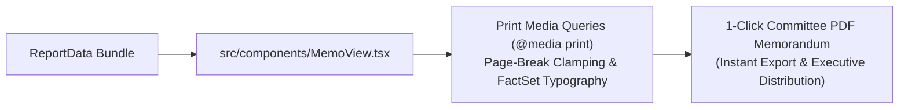

<p align="center">
  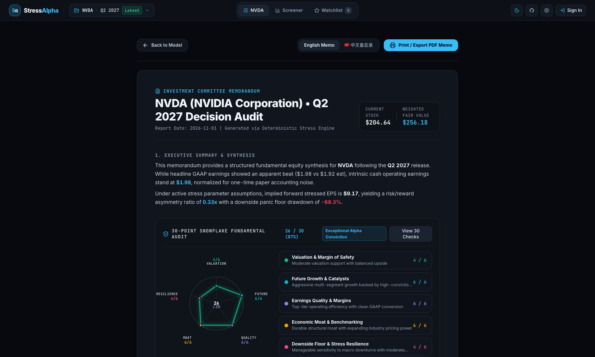
</p>

---

## 9. Verification & Continuous Integration

Every commit is gated by a 5-stage verification pipeline in `.husky/pre-push` and GitHub Actions (`.github/workflows/ci.yml`):

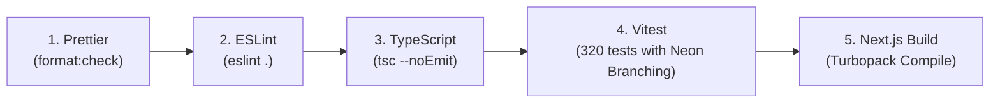

1. **Prettier Formatting**: `npm run format:check`
2. **ESLint Linting**: `npm run lint`
3. **TypeScript Static Analysis**: `npx tsc --noEmit` (0 errors)
4. **Vitest Unit Test Suite**: `npm test` (320 tests across 32 suites)
5. **Next.js Production Build**: `npm run build` (Turbopack compilation)

---

## 10. 5-Pillar Snowflake Fundamental Radar (`src/lib/snowflake.ts`)

The circular fundamental radar evaluates companies across 5 distinct axes (6 points each, 30 points maximum):

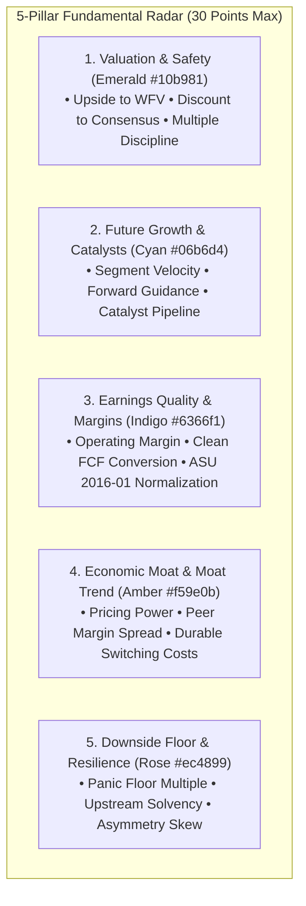

| Pillar | Axis ID | Focus & Evaluation Criteria | Token Color |
| :--- | :--- | :--- | :--- |
| **Valuation & Margin of Safety** | `valuation` | Upside to WFV, discount to consensus target, multiple discipline | Emerald (`#10b981`) |
| **Future Growth & Catalysts** | `future` | Segment revenue velocity, forward guidance, catalyst pipeline | Cyan (`#06b6d4`) |
| **Earnings Quality & Margins** | `earnings` | Operating margin level, clean cash conversion, GAAP equity adjustments | Indigo (`#6366f1`) |
| **Economic Moat & Benchmarking** | `moat` | Pricing power, peer margin spread, durable switching costs | Amber (`#f59e0b`) |
| **Downside Floor & Resilience** | `resilience` | Panic multiple buffer, upstream solvency, asymmetry skew ratio | Rose (`#ec4899`) |

### Scoring Tiers
* **Exceptional Alpha Conviction**: $\ge 24 / 30$
* **High-Quality Investment Grade**: $18 - 23 / 30$
* **Selective Opportunity**: $12 - 17 / 30$
* **Elevated Fundamental Risk**: $< 12 / 30$

---

## 11. CLI Tooling & Autonomous Workflows

| Command | Target Script | Operational Description |
| :--- | :--- | :--- |
| `npm run dev` | Next.js Server | Start development server at `http://localhost:3000` |
| `npm test` | Vitest Runner | Run full 320-test suite across 32 suites with Neon ephemeral branching |
| `npm run build` | Turbopack Build | Compile production Next.js bundle |
| `npm run sync:earnings -- --dry-run` | `sync_earnings_calendar.ts` | Simulate earnings calendar ingestion for today |
| `npm run sync:earnings -- --date=YYYY-MM-DD` | `sync_earnings_calendar.ts` | Ingest and scaffold earnings reports for a specific date |
| `npm run sync:prices` | `sync_prices.ts` | Batch-sync closing prices, TTM/NTM EPS, P/E, and market caps via Yahoo Finance |
| `npm run fetch:data -- <TICKER> --stage` | `fetch_data.ts` | Ingest Yahoo Finance & SEC EDGAR statements and scaffold starter draft modules |
| `npm run backfill:sec` | `backfill_sec_footnotes.ts` | Backfill official SEC EDGAR filings and XBRL accounting footnotes |
| `npm run backfill:technical` | `backfill_technical_universe.ts` | Recompute 1-year Volume POC, VWAP, and S/R corridors across the universe |
| `npm run migrate:metrics` | `migrate_financial_metrics.ts` | Backfill relational quarterly time-series statements into `financial_metrics` |
| `npm run capture:screenshots` | `capture_screenshots.sh` | Capture fresh headless screenshots of all core platform views |

---

## 12. Repository Directory Structure

```
stress-alpha/
├── .github/workflows/
│   ├── ci.yml                          # Continuous integration (format, lint, tsc, test, build)
│   ├── nightly-price-sync.yml          # Nightly Yahoo Finance price & EPS sync (22:00 UTC)
│   └── earnings_sync.yml               # Twice-daily automated earnings scaffolding (8:45 AM & 5:15 PM EST)
├── docs/
│   ├── architecture.md                 # Canonical system architecture documentation & diagrams
│   ├── TELEMETRY_TPS.md                # Data ingestion ownership & rate-budgeting specification
│   └── images/                         # Platform screenshots (cockpit, screener, watchlist, memo, methodology)
├── scripts/
│   ├── sync_earnings_calendar.ts       # Earnings calendar ingestion & 8-module scaffolding
│   ├── sync_prices.ts                  # Batch Yahoo Finance price, EPS & market cap synchronization
│   ├── fetch_data.ts                   # Yahoo Finance & SEC EDGAR pipeline data extractor
│   ├── backfill_sec_footnotes.ts       # SEC EDGAR filing & XBRL footnote backfill script
│   ├── backfill_technical_universe.ts  # Universe-wide technical corridor & Volume POC backfill
│   ├── seed_universe.ts                # S&P 500 & NASDAQ-100 universe ingestion & quote seeder
│   ├── bulk_scaffold.ts                # Batch valuation scaffolding & report persistence engine
│   └── capture_screenshots.sh          # Headless browser screenshot capture script
├── src/
│   ├── app/                            # Next.js 16 App Router pages & API routes
│   │   ├── page.tsx                    # Main router (Market Home, Model Cockpit, Screener, Watchlist)
│   │   ├── screener/                   # Dedicated cross-ticker screener (/screener)
│   │   ├── watchlist/                  # Dedicated coverage watchlist (/watchlist)
│   │   ├── settings/                   # Dedicated settings & privacy hub (/settings)
│   │   ├── methodology/                # Interactive mathematical methodology guide (/methodology)
│   │   └── api/                        # REST API routes (reports, market/summary, earnings/calendar, notes, watchlist, pipeline)
│   ├── components/                     # React 19 UI components
│   │   ├── Header.tsx                  # Global 4-item segmented navigation bar & theme toggle
│   │   ├── Cockpit.tsx                 # Interactive flow-through model & sliders
│   │   ├── CockpitDualPane.tsx         # Desktop dual-pane independent scroll container
│   │   ├── StockNotesModal.tsx         # Cloud + localStorage per-stock analyst notes modal
│   │   ├── ScreenerView.tsx            # Single-row dropdown filter bar, GICS sectors & fixed-width table
│   │   ├── WatchlistView.tsx           # Dedicated watchlist telemetry strip, notes & metrics
│   │   ├── home/                       # MarketHomeView, SP500Treemap & Upcoming Earnings Docket
│   │   ├── snowflake/                  # 5-Pillar Snowflake Radar chart & modal
│   │   └── tabs/                       # 3 Streamlined intelligence workspaces (Technicals, Valuation, Estimates)
│   ├── db/                             # Neon Serverless Postgres schema & connection pool
│   └── lib/                            # Core domain logic
│       ├── valuation.ts                # Deterministic arithmetic, FCF metrics & scenario calibration
│       ├── snowflake.ts                # 30-point fundamental health scoring engine
│       ├── sanity.ts                   # Variant perception & data completeness audit
│       ├── sectors.ts                  # 11 GICS sector classifications & constituent mappings
│       ├── treemap.ts                  # Deterministic squarified treemap layout engine
│       ├── notes.ts                    # Hybrid cloud + localStorage per-stock analyst notes client
│       ├── services/                   # Earnings calendar, Yahoo/SEC financial data, and AI gateway services
│       └── repository/                 # Data Access Layer (Drizzle & InMemory repositories)
└── tests/                              # Vitest automated test suite (320 tests across 32 suites)
```
